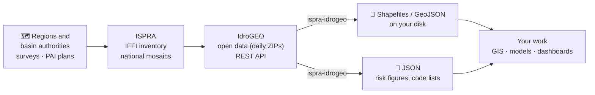
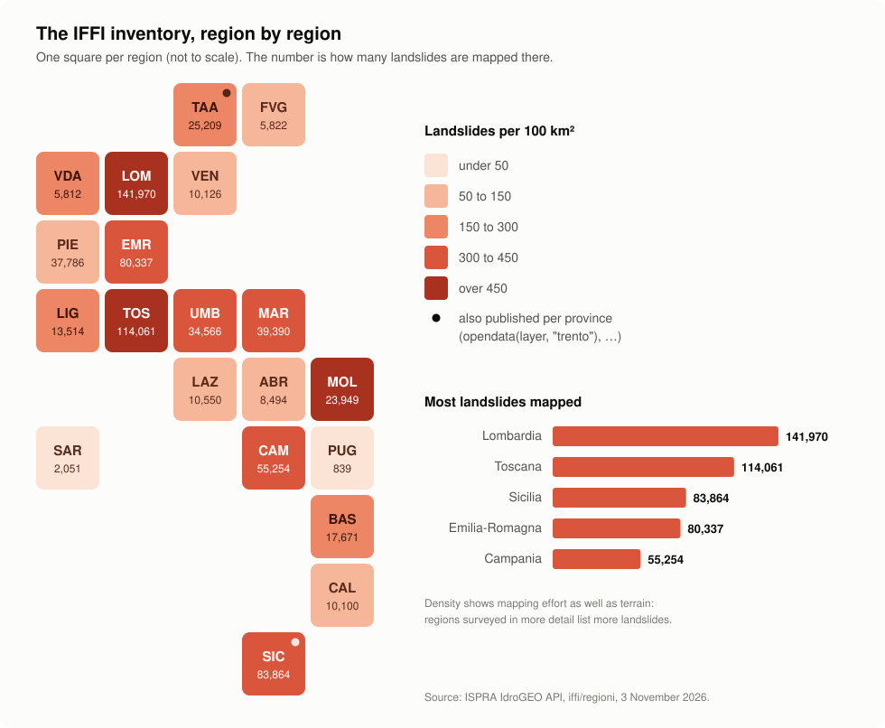
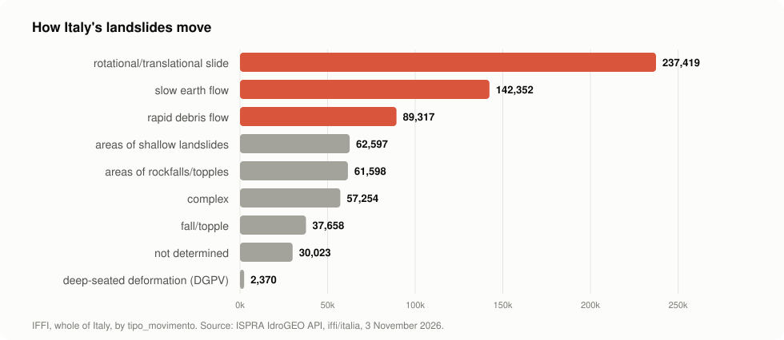
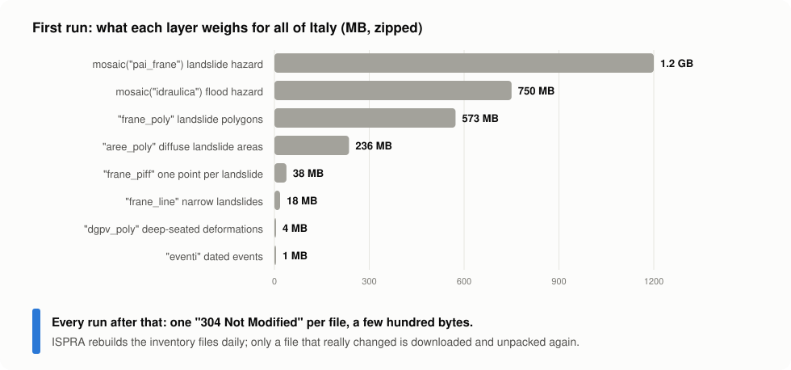
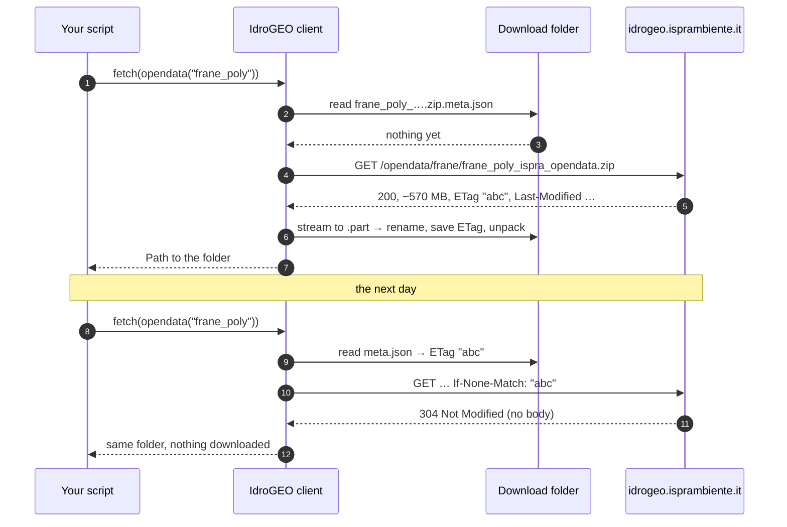
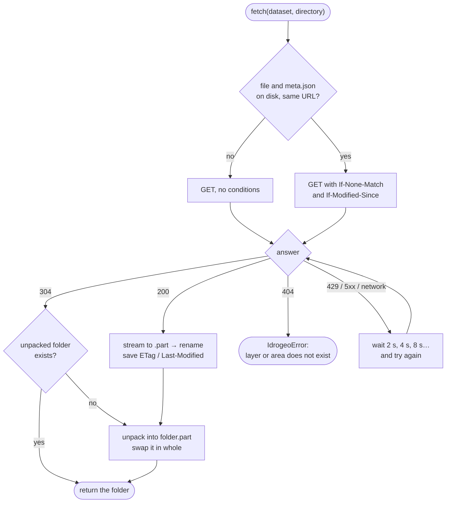
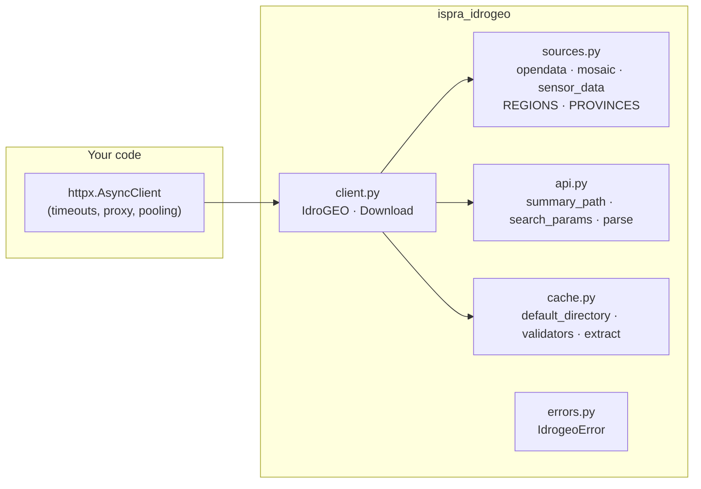

<p align="center">
  
</p>

<p align="center">
  <a href="https://github.com/agent-engineering-studio/ispra-idrogeo/actions/workflows/ci.yml"></a>
  <a href="https://pypi.org/project/ispra-idrogeo/"></a>
  
  
  
  <a href="./LICENSE"></a>
</p>

**ispra-idrogeo** is a small, typed, async Python library for
[IdroGEO](https://idrogeo.isprambiente.it/), the platform where ISPRA (Italy's
national environmental agency) publishes what it knows about **landslides and
floods** in Italy. With it, a script can download the national landslide
inventory and the hazard maps, keep them up to date, and ask the IdroGEO API
for risk figures about any region, province or town. No browser, no
copy-pasted links, no account.

```python
async with IdroGEO() as idrogeo:
    folder = await idrogeo.fetch(opendata("frane_piff"))  # 721,365 landslides, one point each
```

---

## Contents

- [What is IdroGEO, in 30 seconds](#what-is-idrogeo-in-30-seconds)
- [What this library does](#what-this-library-does)
- [Who is it for](#who-is-it-for)
- [Quick start](#quick-start)
- [What you can download](#what-you-can-download)
- [Where downloads are saved](#where-downloads-are-saved)
- [How it works](#how-it-works)
- [Recipes](#recipes)
- [The traps we already fell into](#the-traps-we-already-fell-into)
- [API at a glance](#api-at-a-glance)
- [Contributing](#contributing) · [Ideas to work on](#ideas-to-work-on)
- [Data licence and credits](#data-licence-and-credits)

---

## What is IdroGEO, in 30 seconds

Italy is one of the European countries most exposed to landslides and floods.
For decades, ISPRA and the regions have mapped every landslide they found into
one national database, **IFFI** (*Inventario dei Fenomeni Franosi in Italia*),
and the river basin authorities have drawn **hazard maps** (the **PAI** plans)
of where the ground may slide and where rivers may flood. ISPRA joins the
regional maps into national **mosaics**, and puts everything on **IdroGEO**:
a web map, open-data files and a public REST API.



Some of what is in there, straight from the API:

| Italy, November 2026 | |
|---|---|
| Landslides mapped in IFFI | **721,365** |
| Land in high or very high landslide hazard (PAI P3 + P4) | **9.5 %** of the country, 28,801 km² |
| People living there | **1.28 million** |
| People living in areas that can flood once in 100–200 years (P2) | **6.8 million**, 11.5 % of the population |
| Dated landslide events recorded since 2018 | **1,290** |

<p align="center">
  
</p>

<p align="center">
  
</p>

## What this library does

| | Feature | In plain words |
|---|---|---|
| 📦 | **Every open-data file** | IFFI points, polygons and lines, diffuse-landslide areas, deep-seated deformations, dated events, reports, the two national hazard mosaics, the monitoring readings. |
| 🗺️ | **Italy or one area** | The whole country, or one of 19 regions, or a province that publishes on its own (Bolzano, Trento, the Sicilian ones). Shapefile or GeoJSON. |
| 💾 | **A folder that stays** | Files go to a persistent folder and are unpacked next to themselves, ready for GeoPandas or QGIS. |
| 🔁 | **Download once, then only what changed** | Each file remembers its `ETag` and `Last-Modified`. The next run asks "changed?" and gets a `304` for a few hundred bytes. |
| 🛡️ | **Never half a file** | Downloads stream to `.part` and are renamed when complete; ZIPs unpack beside the old folder and are swapped in whole. Memory stays flat even for 1.2 GB. |
| 📊 | **The REST API** | Landslide counts and hazard and risk indicators for Italy, macro-regions, regions, provinces, municipalities; every municipality at once, kept on disk; code lists; paged searches. |
| 🔄 | **Retries built in** | Network errors, 429 and 5xx are retried with exponential backoff. Bring your own `httpx.AsyncClient` if you want to tune it. |
| 🧪 | **Pure functions too** | URL builders, request builders and parsers have no network, for your own HTTP stack. |

One dependency: [`httpx`](https://www.python-httpx.org/).

## Who is it for

- **Researchers and students** in geology, hydrology, civil engineering and
  remote sensing who want IFFI or PAI in a notebook.
- **GIS analysts and data engineers** who keep a copy of the national layers
  and want it refreshed every night without downloading 3 GB every night.
- **Civil protection, planning and infrastructure teams** who need the risk
  figures of a town, a province or a region, from a script.
- **Journalists and civic-tech projects** telling the story of landslides and
  floods in Italy with numbers you can check.

It started inside [Limen](https://github.com/agent-engineering-studio/limen),
a multi-hazard risk monitor for Italy, where IFFI landslides and PAI hazard
are inputs of a landslide-risk model, and was extracted so that anyone can use
it.

---

## Quick start

### 1. Install

```bash
pip install ispra-idrogeo
```

Python 3.12 or newer. No account and no API key: IdroGEO open data is public.

### 2. Download your first layer

```python
import asyncio

from ispra_idrogeo import IdroGEO, opendata


async def main() -> None:
    async with IdroGEO() as idrogeo:
        folder = await idrogeo.fetch(opendata("frane_piff", "molise"))
        print(folder)  # ~/.cache/ispra-idrogeo/frane_piff_molise_opendata
        print(sorted(p.name for p in folder.iterdir()))
        # ['frane_piff_opendataPoint.cst', '….dbf', '….prj', '….shp', '….shx']


asyncio.run(main())
```

That's it: a shapefile with the 23,949 landslides mapped in Molise, one point
each. Run it again and it costs one `304 Not Modified`.

### 3. Look at it

With `pip install geopandas matplotlib`:

```python
import geopandas as gpd

landslides = gpd.read_file(next(folder.glob("*.shp")))
print(landslides.crs)  # EPSG:32632 (WGS 84 / UTM 32N)
print(landslides["nome_tipo"].value_counts().head(3))
# Colamento lento                        9168   ← slow earth flow
# Complesso                              7606   ← complex
# Scivolamento rotazionale/traslativo    4279   ← slide

landslides.plot(column="nome_tipo", markersize=1, legend=True, figsize=(10, 8))
```

Each point carries the landslide's IFFI id (`id_frana`), its type of movement
(`tipo_movim`, `nome_tipo`), and the region, province, municipality and river
basin district it falls in.

### 4. Ask the API

```python
async with IdroGEO() as idrogeo:
    bari = await idrogeo.summary("pir", "comuni", 72006)  # ISTAT code of Bari
    print(bari["nome"], bari["pop_res021"], bari["popidp2_p"])
    # Bari 315948 1.278  → 1.3 % of residents in flood hazard P2
```

---

## What you can download

<p align="center">
  
</p>

| You write | What it is | Italy, zipped |
|---|---|---|
| `opendata("frane_piff")` | IFFI landslide identification points, one per landslide | 38 MB |
| `opendata("frane_poly")` | IFFI landslide polygons (the outline of each landslide) | 573 MB |
| `opendata("frane_line")` | IFFI landslides too narrow for a polygon | 18 MB |
| `opendata("aree_poly")` | areas of diffuse landslides (many small ones together) | 236 MB |
| `opendata("dgpv_poly")` | deep-seated gravitational slope deformations | 4 MB |
| `opendata("eventi")` | dated landslide events (points) | 1 MB |
| `opendata("segnalazioni")` | reports | small |
| `mosaic("pai_frane")` | PAI landslide hazard mosaic 2020-2021 | 1.2 GB |
| `mosaic("idraulica")` | flood hazard mosaic 2020 | 0.75 GB |
| `sensor_data()` | monitoring network readings, CSV (bzip2) | |

Every `opendata` layer comes:

- for **Italy** (`area="ispra"`, the default), for one **region**
  (`REGIONS`, by ISTAT code: `REGIONS[16] == "puglia"`) or for a **province**
  that publishes on its own (`PROVINCES`: Bolzano, Trento, the nine Sicilian
  ones);
- as a **shapefile** (default) or **GeoJSON** (`fmt="geojson"`).

```python
opendata("frane_poly", "toscana")  # one region, shapefile
opendata("frane_piff", "trento", "geojson")  # one autonomous province, GeoJSON
opendata("eventi")  # all of Italy
```

Coordinates are in **EPSG:32632** (WGS 84 / UTM 32N), for every area.

---

## Where downloads are saved

In a folder that should survive restarts, because the national files weigh
hundreds of MB:

1. the `directory` you pass to `fetch` or `download`;
2. otherwise `IDROGEO_DATA_DIR`, if set;
3. otherwise `~/.cache/ispra-idrogeo` (or `$XDG_CACHE_HOME/ispra-idrogeo`).

```text
~/.cache/ispra-idrogeo/
├── frane_piff_ispra_opendata.zip             # the download, kept to revalidate it
├── frane_piff_ispra_opendata.zip.meta.json   # URL, ETag, Last-Modified
└── frane_piff_ispra_opendata/                # unpacked, ready to read
    ├── frane_piff_opendataPoint.shp
    └── …
```

In **Docker**, point it at a volume so the data survives the container:

```yaml
services:
  app:
    environment:
      IDROGEO_DATA_DIR: /data/idrogeo
    volumes:
      - idrogeo-data:/data/idrogeo
volumes:
  idrogeo-data:
```

---

## How it works

### Download once, then only what changed

ISPRA rebuilds the inventory files **every day**
and sends an `ETag` and a `Last-Modified` with each one. The library
saves them next to the file and sends them back the next time: the server
answers `304 Not Modified` if the copy you have is still current.



### What `fetch` decides



A reader never finds half a file or half a shapefile, and a ZIP member that
would land outside its folder (`../../etc/…`) is refused.

### The building blocks

The library has two layers. Use the high-level client, or call the pure
functions with any HTTP library you like.



- **`sources.py`, `api.py`**: pure functions, no network. They build URLs and
  requests and read answers. Easy to test, easy to reuse.
- **`cache.py`**: the folder, the `.meta.json` validators and the safe unpacking.
- **`client.py`**: `IdroGEO` wires them to **your** `httpx.AsyncClient`.

---

## Recipes

### Keep a national copy fresh, every night

```python
from ispra_idrogeo import LANDSLIDE_LAYERS, IdroGEO, mosaic, opendata

async with IdroGEO() as idrogeo:
    for layer in LANDSLIDE_LAYERS:
        got = await idrogeo.download(opendata(layer))
        print(layer, "updated" if got.changed else "unchanged")
    for name in ("pai_frane", "idraulica"):
        await idrogeo.fetch(mosaic(name))
```

The first run downloads about 3 GB. Put it in a cron job: the following runs
cost a few kilobytes, plus whatever ISPRA really changed.

### Landslides per region (the map above)

```python
from ispra_idrogeo import IdroGEO

async with IdroGEO() as idrogeo:
    for region in await idrogeo.summary("iffi", "regioni"):
        counts = await idrogeo.summary("iffi", "regioni", region["cod_reg"])
        hazard = await idrogeo.summary("pir", "regioni", region["cod_reg"])
        density = counts["frane_totali"] / hazard["ar_kmq"] * 100
        print(f"{region['nome']:<22} {counts['frane_totali']:>8,}  {density:5.0f} per 100 km²")
# Piemonte                 37,786    149 per 100 km²
# Valle d'Aosta             5,812    178 per 100 km²
# Lombardia               141,970    595 per 100 km²
# …
```

`summary("iffi", …)` gives landslide counts (also by type, in
`frane_stats`); `summary("pir", …)` gives hazard and risk indicators: areas,
residents, families, buildings, businesses and cultural heritage in each
landslide (`*_fr_*`) and flood (`*_idr_*`) hazard class. Levels are
`"italia"`, `"macroregioni"`, `"regioni"`, `"province"` and `"comuni"`, by
ISTAT code.

### Every municipality, in one table

```python
from datetime import timedelta

from ispra_idrogeo import IdroGEO

async with IdroGEO() as idrogeo:
    rows = await idrogeo.municipalities("pir", max_age=timedelta(days=30))
print(len(rows))  # 7899
worst = sorted(rows, key=lambda r: r["pop_fr_p3"] + r["pop_fr_p4"], reverse=True)[:3]
for r in worst:
    print(r["nome"], r["pop_fr_p3"] + r["pop_fr_p4"], f"{r['popfrp3p4p']:.1f} %")
# Napoli 42390 4.6 %     ← residents in landslide hazard P3 + P4, and their share
# Genova 30148 5.4 %
# Sanremo 14607 27.6 %
```

One call lists the municipalities, then one call each asks for its
indicators, 8 at a time: about a minute and 17 MB for all of Italy. Each
answer is saved as `<directory>/pir_comuni/<ISTAT code>.json`, so the next
run reads it back from disk (under two seconds), an interrupted run resumes
where it stopped, and `max_age` decides when an answer is old enough to ask
again. The indicators come from the 2020-2021 hazard mosaics and the 2021
census, so a monthly refresh is plenty.

`municipalities("iffi")` does the same with landslide counts, and
`summaries(summary, "regioni" | "province" | "comuni")` with any level.

### Translate the codes

The files store codes; the API has the code lists, in five languages:

```python
async with IdroGEO() as idrogeo:
    print(len(await idrogeo.dictionaries()))  # 73 lists: causes, damage, materials…
    types = {d["codice"]: d["descrizione_en"] for d in await idrogeo.dictionary("tipo_movimento")}
    # {'1': 'fall/topple', '2': 'rotational/translational slide', '4': 'slow earth flow', …}
```

### Walk through every landslide or event

```python
async with IdroGEO() as idrogeo:
    sinkholes = [f async for f in idrogeo.iter_landslides({"tipo_movimento": 6})]
    print(len(sinkholes))  # 500, the same as IFFI's national count

    async for event in idrogeo.iter_events({"regione": "eq.16"}):  # Puglia
        print(event["uid"], event["computed_date"], event["comune_nome"])
```

`iter_landslides` and `iter_events` ask for one page after another
(`page_size`, 1,000 by default) and stop at the last one. They sort by a
unique key (`id_frana`, `uid`) so pages do not overlap. Each search has
its own filter syntax: landslides take plain values (`{"tipo_movimento":
6}`), events take operators (`{"regione": "eq.16"}`). An empty filter
matches everything. `search_landslides` and `search_events` return a single
page, if you prefer to page yourself.

### One landslide, in full

```python
async with IdroGEO() as idrogeo:
    record = await idrogeo.landslide("0017680500")
print(len(record), record["stato"])  # 142 validato_ispra
# activations, causes, state and velocity, damage, interventions, precursors…
```

The full record of a validated landslide. Many fields are often empty, so
check before you rely on them. An unknown id raises `IdrogeoError` (IdroGEO
answers 401 to it, not 404).

### Bring your own HTTP client

```python
import httpx

from ispra_idrogeo import IdroGEO

http = httpx.AsyncClient(timeout=httpx.Timeout(30, read=600), proxy="http://proxy:3128")
async with IdroGEO(http, retries=0) as idrogeo:  # your client, your retry policy
    ...
await http.aclose()  # the client is yours: IdroGEO does not close it
```

### Handle errors

```python
import httpx

from ispra_idrogeo import IdrogeoError

try:
    folder = await idrogeo.fetch(opendata("frane_piff", "puglia"))
except IdrogeoError as exc:
    # IdroGEO answered, but not with what was asked: 404, API refusal, not JSON.
    print("IdroGEO said no:", exc)
except httpx.HTTPError as exc:
    # Network problems still failing after the retries.
    print("network:", exc)
```

An unknown layer, area or mosaic name raises `ValueError` before any request.

---

## The traps we already fell into

IdroGEO works well, but its older documentation and many scripts on the web
point to paths that no longer exist. This library handles these for you:

| You try | What actually happens | What ispra-idrogeo does |
|---|---|---|
| `/opendata/iffi/<region>/iffi_<region>_<layer>.zip`, as in older guides | HTTP **404** in 2026: the files moved | uses `/opendata/frane/<layer>_<area>_opendata.zip` |
| the dictionaries in `/opendata/iffi/dizionari/*.json` | HTTP **404**: they moved to the API | reads `/api/dizionari` |
| the WFS at `geoserver/idrogeo/frane/ows` | HTTP **401**, and the GeoServer lists no layer anonymously | uses the open downloads and the API |
| a file for `trentino-alto-adige` | there is none: it publishes per province | offers `bolzano` and `trento` in `PROVINCES` |
| downloading the inventory again every day "to be safe" | ~870 MB a day, whether anything changed or not | conditional GET: one `304` when nothing changed |
| `/api/evento/{id}`, which the OpenAPI lists with no login | HTTP **401** without a login (`/api/frana/{id}` does answer 200) | reads events through `search_events`, which is public |
| reading the shapefile while a new version is unpacking | half a shapefile, or a crash | unpacks beside it and swaps the folder in whole |

All checked against the live service on 3 November 2026.

---

## API at a glance

| Name | What it does |
|---|---|
| `IdroGEO(client=None, *, retries=3, backoff_s=2.0)` | The async client; opens (and closes) its own HTTP client if not given one. |
| `.fetch(dataset, directory=None, *, unpack=True)` | The dataset ready to read: the unpacked folder, or the file. |
| `.download(dataset, directory=None)` | `Download(path, changed)`: the file, and whether this call changed it. |
| `.summary(summary, level, code=None)` | `"iffi"` counts or `"pir"` indicators; without `code`, the list of that level. |
| `.dictionaries()` / `.dictionary(name)` | The names of the code lists / one list. |
| `.landslide(id_frana)` | The full record of one validated landslide. |
| `.iter_landslides(filters, page_size=1000, select=, order="id_frana")` | Every matching IFFI landslide, page after page. |
| `.iter_events(filters, page_size=1000, select=, order="uid")` | Every matching landslide event, page after page. |
| `.search_landslides(filters, limit=, offset=, select=, order=)` | One page of IFFI landslides. |
| `.search_events(filters, limit=, offset=, select=, order=)` | One page of validated landslide events. |
| `.municipalities(summary="pir", directory=None, *, concurrency=8, max_age=None)` | The summary of all 7,899 municipalities, saved one JSON per municipality. |
| `.summaries(summary, level, directory=None, *, concurrency=8, max_age=None)` | The same for every region, province or municipality. |
| `opendata(layer, area="ispra", fmt="shapefile")` | An open-data `Dataset` (URL + file name). |
| `mosaic("pai_frane" \| "idraulica")` | A national hazard mosaic. |
| `sensor_data()` | The monitoring network readings. |
| `REGIONS` / `PROVINCES` / `region_area(cod_reg)` | Area file names by ISTAT code. |
| `LANDSLIDE_LAYERS` / `EVENT_LAYERS` / `MOSAICS` | What there is. |
| `default_directory()` | Where downloads go when no directory is given. |
| `IdrogeoError` | IdroGEO answered, but not with what was asked for. |

Lower level, for your own HTTP layer: `summary_path`, `search_params`,
`level_codes`, `parse` / `parse_list`, `read_validators` / `write_validators`,
`read_json` / `write_json`, `extract`.

---

## Contributing

Contributions of every size are welcome, from a typo to a new feature. You
don't need to be a geologist: most of the code is plain Python, HTTP and
files.

```bash
git clone https://github.com/agent-engineering-studio/ispra-idrogeo
cd ispra-idrogeo
uv sync          # install everything, dev tools included
make check       # ruff + mypy --strict + pytest, the same gate as CI
```

The tests **need no network**: they run against a mocked transport
(`httpx.MockTransport`), so they are fast and never hit ISPRA's servers.

```text
ispra-idrogeo/
├── src/ispra_idrogeo/
│   ├── sources.py   # where the open data lives: pure URL builders
│   ├── api.py       # REST API requests and parsers
│   ├── cache.py     # the persistent folder, ETag/Last-Modified, safe unzip
│   ├── client.py    # IdroGEO: async client, retries, streaming
│   └── errors.py    # IdrogeoError
├── docs/
│   ├── make_figures.py  # redraws docs/images/ from the live API
│   └── images/          # the figures of this README
└── tests/
```

How to propose a change:


Rules are short: see [CONTRIBUTING.md](./CONTRIBUTING.md). Commits follow
[Conventional Commits](https://www.conventionalcommits.org/), coverage stays
above 90%, and contributions are accepted under Apache-2.0.

### Ideas to work on

Not promises, just directions where help would make a difference. Open an
issue to discuss one before starting.

| Idea | Why it matters | Good for |
|---|---|---|
| 📓 **Example notebooks** (a town, a valley, a flood plain) | Show what the data can do | first contribution, GIS users |
| 🖥️ **Command line**: `idrogeo fetch frane_piff --area puglia` | Use it with no Python | first contribution |
| 📊 **Progress bar** for the big downloads | 1.2 GB feels less like a black box | first contribution |
| 🐼 **Load into GeoPandas / GeoParquet** (optional extra) | Layers and summaries as data frames in one line | intermediate |
| 🔎 **Typed search filters** | Build filters without reading the manual | intermediate |
| 🌍 **Translate codes in the files** with the dictionaries | `tipo_movim = 4` → "slow earth flow", in five languages | intermediate |
| 📈 **Read the monitoring CSV** (`sensor_data()`) | Sensor time series next to the landslides | intermediate |
| 📚 **Documentation site** | Search, API reference, tutorials | anyone |

Found something odd in IdroGEO? That is a contribution too: open an issue
with what you sent and what came back.

---

## Data licence and credits

Unless stated otherwise, ISPRA publishes its data under
[CC BY 4.0](https://creativecommons.org/licenses/by/4.0/legalcode)
([note legali](https://www.isprambiente.gov.it/it/note-legali)). Anything you
publish from it **must credit the source**, for example:

> Source: ISPRA — IdroGEO, Italian landslide inventory (IFFI) and national hazard mosaics.

This library only downloads the data. The figures in this README are drawn
from IdroGEO API answers of 3 November 2026 (redraw them with
`uv run python docs/make_figures.py`); the region map is a schematic tile
map, not a geographic one.

Code: [Apache-2.0](./LICENSE). Extracted from
[Limen](https://github.com/agent-engineering-studio/limen).

If this project is useful to you, a ⭐ on GitHub helps others find it.
