<p align="center">
  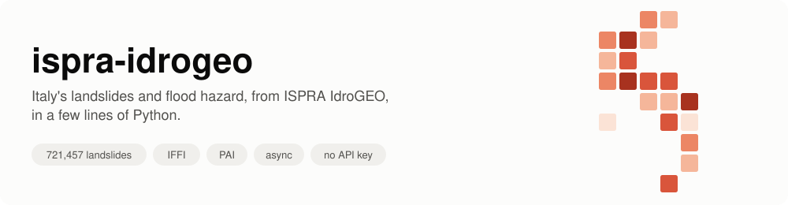
</p>

<p align="center">
  <a href="https://github.com/agent-engineering-studio/ispra-idrogeo/actions/workflows/ci.yml"></a>
  <a href="https://pypi.org/project/ispra-idrogeo/"></a>
  
  
  
  <a href="./LICENSE"></a>
  <a href="https://agentengineering.it/ispra-idrogeo/"></a>
</p>

**ispra-idrogeo** brings Italy's official data on **landslides and floods**
into your code, and tells you **how far you can trust it**.

The data comes from [IdroGEO](https://idrogeo.isprambiente.it/), the platform
of ISPRA, Italy's national environmental agency. With this library you can:

- **download** the national landslide inventory and the hazard maps, and keep
  them fresh by downloading only what changed;
- **ask** for the risk figures of any region, province or town;
- **check a place**: is this point in a hazard area? Which landslides are near?
- **find the landslides with a date**, and how precise that date is;
- **know how far to trust** the data in each town, and say what is not measured;
- **put it on a map** for a town's website, or **give it to an AI agent**.

No browser, no account, no API key. It reads no rain and gives no alert:
for warnings, follow the bulletins of the Civil Protection.

```python
async with IdroGEO() as idrogeo:
    folder = await idrogeo.fetch(opendata("frane_piff"))  # 721,457 landslides, one point each
```

### In one picture

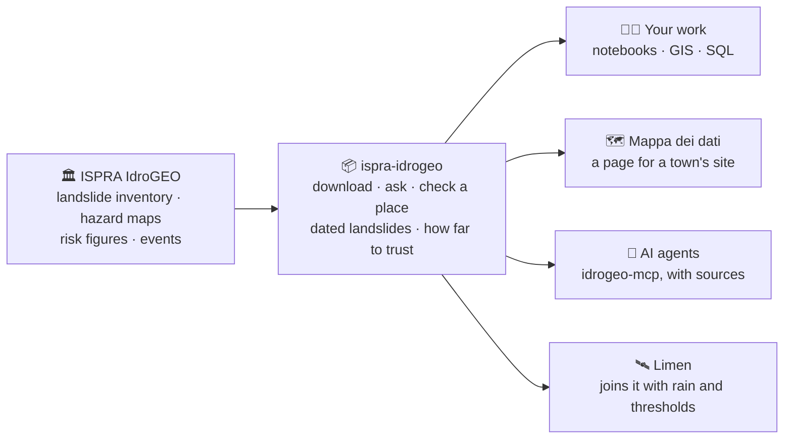

### Jump to what you need

| I want to… | Example |
|---|---|
| download a layer and open it | [Quick start](#quick-start) |
| use the command line | [From the command line](#3b-or-from-the-command-line) |
| start everything in Docker with one command | [Run it in containers](#run-it-in-containers) |
| put a map on a municipality's site | [A map for public bodies](#a-map-for-public-bodies) |
| know if a place is in a hazard area | [Hazard at a point](#is-this-place-at-risk-hazard-at-a-point) |
| find the landslides near a place | [Landslides near a point](#landslides-near-a-point) |
| get the risk figures of a town | [Ask the API](#4-ask-the-api) · [Every municipality](#every-municipality-in-one-table) |
| count landslides by region | [Landslides per region](#landslides-per-region-the-map-above) |
| search landslides and events | [Walk through every landslide or event](#walk-through-every-landslide-or-event) |
| use dated landslides (rainfall thresholds) | [Dated landslides](#dated-landslides-when-and-how-precisely) |
| know how far to trust IFFI in a place | [How far to trust the data](#how-far-to-trust-the-data-place-by-place) |
| know when ISPRA last changed a file | [Freshness](#when-did-ispra-last-change-each-file) |
| keep a copy fresh every night | [Keep a national copy fresh](#keep-a-national-copy-fresh-every-night) · [Only what changed](#only-what-changed-since-last-time) · [Watch](#watch-for-changes) |
| turn codes into words | [Translate the codes](#translate-the-codes) |
| put API rows on a map | [API rows on a map](#api-rows-on-a-map) |
| work offline, in SQL | [A local warehouse](#offline-many-places-at-once-your-own-sql-a-local-warehouse) |
| give the data to an AI agent | [The MCP server](#for-ai-agents-the-mcp-server) |
| know where AI helps, and use my Anthropic key | [AI: where it helps](#ai-where-it-helps) |
| check that everything works | [Test notebook](#example-notebooks) · [Known cases](#known-cases) |
| credit the data correctly | [Data licence and credits](#data-licence-and-credits) |

---

## Contents

- [What is IdroGEO, in 30 seconds](#what-is-idrogeo-in-30-seconds)
- [What this library does](#what-this-library-does)
- [Who is it for](#who-is-it-for)
- [Quick start](#quick-start)
- [What you can download](#what-you-can-download)
- [Where downloads are saved](#where-downloads-are-saved)
- [A map for public bodies](#a-map-for-public-bodies)
- [Run it in containers](#run-it-in-containers)
- [How it works](#how-it-works)
- [Recipes](#recipes)
- [Example notebooks](#example-notebooks)
- [AI: where it helps](#ai-where-it-helps)
- [The traps we already fell into](#the-traps-we-already-fell-into)
- [Known cases](#known-cases)
- [API at a glance](#api-at-a-glance)
- [Contributing](#contributing) · [Ideas to work on](#ideas-to-work-on)
- [Data licence and credits](#data-licence-and-credits)

---

## What is IdroGEO, in 30 seconds

<!-- --8<-- [start:intro] -->

Italy is one of the European countries most exposed to landslides and floods.
Three things are known about them, and IdroGEO publishes all three:

1. **Where landslides happened.** For decades ISPRA and the regions have
   mapped every landslide they found into one national inventory, **IFFI**
   (*Inventario dei Fenomeni Franosi in Italia*).
2. **Where the ground may slide or rivers may flood.** The river basin
   authorities draw **hazard maps**, the **PAI** plans, in classes from P1
   (low) to P4 (very high). ISPRA joins them into national **mosaics**.
3. **Who and what is exposed.** From those maps and the census, ISPRA counts
   the people, buildings and cultural heritage in each hazard class, town by
   town.

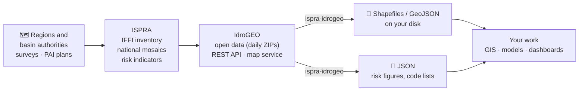

Some of what is in there, straight from the API:

| Italy, November 2026 | |
|---|---|
| Landslides mapped in IFFI | **721,457** |
| … of which with a date | **28,076** (3.9%), 10,822 to the day |
| Land in high or very high landslide hazard (PAI 2024, P3 + P4) | **9.5 %** of the country, 28,801 km² |
| People living there | **1.28 million** |
| People living in areas that can flood once in 100–200 years (P2) | **6.8 million**, 11.5 % of the population |
| Dated landslide events since 2018 (open-data file) | **1,710** |

<p align="center">
  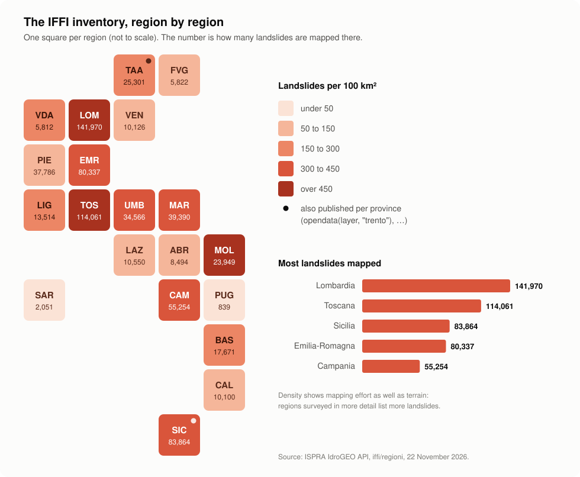
</p>

<p align="center">
  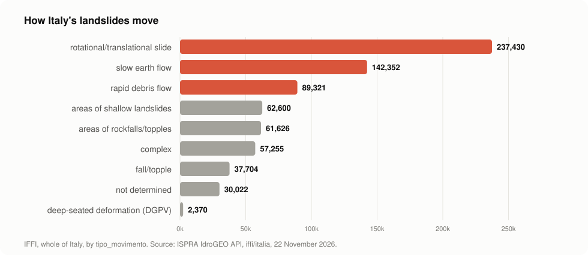
</p>

<!-- --8<-- [end:intro] -->

## What this library does

<!-- --8<-- [start:features] -->

| | What | In plain words |
|---|---|---|
| 📦 | **Every open-data file** | The landslide points, outlines and lines, areas of many small landslides, deep-seated deformations, dated events, reports, the hazard maps (landslides 2020-21 and 2024, floods 2020), the monitoring readings. For Italy, a region or a province. |
| 🔁 | **Download once, then only what changed** | Files go to a folder that stays. The next run asks IdroGEO "changed?" and gets a short "no" when nothing did. Never half a file, even at 1.2 GB. |
| 📊 | **Risk figures** | Landslide counts, hazard areas, people, buildings and heritage exposed, for Italy, regions, provinces and all 7,899 towns. |
| 📍 | **Check a place** | The hazard class of a point, its town and slope; the landslides around it, nearest first. One request, no big download. |
| 📅 | **Landslides with a date** | `dated_landslides`: every dated landslide of IFFI and the events, with how precise its date (hour, day, interval) and its point are. |
| 🧭 | **How far to trust the data** | `reliability`: for every town, how many landslides are dated, how recently the records were touched, and what nobody measured. |
| 🕒 | **How fresh the data is** | `freshness`: when ISPRA last changed each file, without downloading it. |
| 🗺️ | **A map for a town's site** | The *Mappa dei dati*: hazard, landslides, exposure and trust for one town, in Italian, in Docker. |
| 🤖 | **For AI agents** | `idrogeo-mcp`: the same data as tools; every answer names its source and licence, and a check finds invented numbers. |
| ✅ | **Checked** | 100% test coverage, known cases replayed in CI, the live service tested every day. |

One dependency for the core: [`httpx`](https://www.python-httpx.org/).

<!-- --8<-- [end:features] -->

## Who is it for

<!-- --8<-- [start:audience] -->

- **Researchers and students** in geology, hydrology and civil engineering who
  want IFFI or PAI in a notebook, and need to know which landslides have a
  date.
- **GIS analysts and data engineers** who keep a copy of the national layers
  fresh every night without downloading 3 GB every night.
- **Municipalities and public bodies** that want a page on their site with
  what the official data says about their territory.
- **Civil protection, planning and infrastructure teams** who need the figures
  of a town, a province or a region, from a script.
- **Journalists and civic-tech projects** telling the story of landslides and
  floods with numbers you can check.

It started inside [Limen](https://github.com/agent-engineering-studio/limen),
a multi-hazard risk monitor for Italy, and was extracted so that anyone can
use it. The libraries do not depend on one another: only Limen joins them.

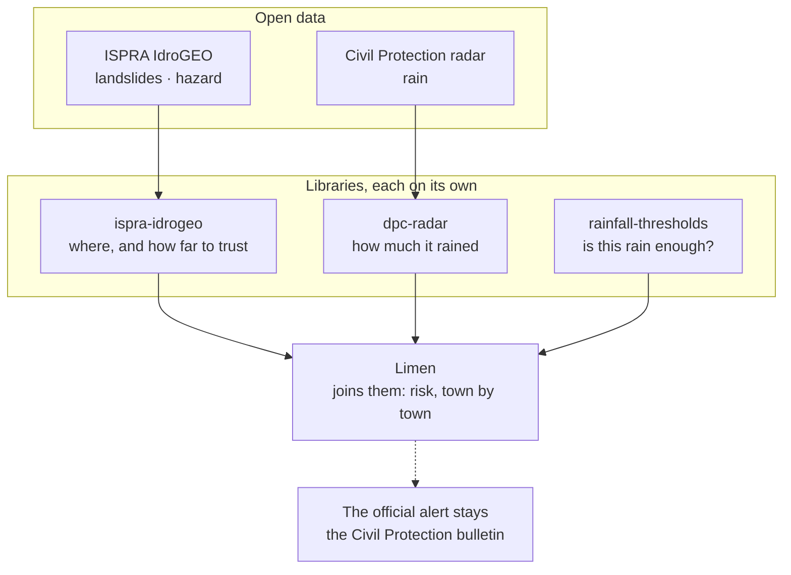

<!-- --8<-- [end:audience] -->

---

## Quick start

<!-- --8<-- [start:quickstart] -->

### 1. Install

```bash
pip install ispra-idrogeo            # downloads, API, the idrogeo command
pip install "ispra-idrogeo[geo]"     # + GeoDataFrames and GeoParquet (geopandas, pyarrow)
pip install "ispra-idrogeo[warehouse]"  # + a local DuckDB copy, offline and in SQL
```

Python 3.12 or newer. No account and no API key: IdroGEO open data is public.

### 2. Download your first layer

```python
import asyncio

from ispra_idrogeo import IdroGEO, opendata


async def main() -> None:
    async with IdroGEO() as idrogeo:
        folder = await idrogeo.fetch(opendata("frane_piff", "molise"))
        print(folder)  # ~/.cache/ispra-idrogeo/frane_piff_molise_opendata
        print(sorted(p.name for p in folder.iterdir()))
        # ['frane_piff_opendataPoint.cst', '….dbf', '….prj', '….shp', '….shx']


asyncio.run(main())
```

That's it: a shapefile with the 23,949 landslides mapped in Molise, one point
each. Run it again and it costs one `304 Not Modified`.

### 3. Look at it

With `pip install "ispra-idrogeo[geo]" matplotlib`:

```python
from ispra_idrogeo.geo import add_labels, read

labels = await idrogeo.code_labels(["tipo_movim"])  # inside the `async with` above
landslides = add_labels(read(folder), labels)  # the folder from step 2
print(landslides.crs)  # EPSG:32632 (WGS 84 / UTM 32N)
print(landslides["tipo_movim_label"].value_counts().head(3))
# slow earth flow                   9168
# complex                           7606
# rotational/translational slide    4279

landslides.plot(column="tipo_movim_label", markersize=1, legend=True, figsize=(10, 8))
landslides.to_parquet("molise.parquet")  # GeoParquet, for DuckDB, QGIS, BigQuery…
```

Each point carries the landslide's IFFI id (`id_frana`), its type of movement
(`tipo_movim`, `nome_tipo`), and the region, province, municipality and river
basin district it falls in.

### 3b. Or from the command line

```bash
idrogeo fetch frane_piff --area molise              # prints the unpacked folder
idrogeo summary pir comuni 72006 | jq .popidp2_p    # 1.278
idrogeo municipalities --max-age-days 30 > comuni.jsonl
idrogeo municipalities --region 16 > puglia.jsonl     # only Puglia's 257
idrogeo landslides --since 2026-11-01T00:00:00Z --select '*' > changed.jsonl
idrogeo landslides --municipality 65135             # Sarno's 53 landslides
idrogeo sites --filter stato_monitoraggio=eq.1 --select uid,point
idrogeo labels tipo_movimento --lang it
idrogeo hazard 40.829 14.617                        # P4, Sarno, 12.3°
```

Downloads print the path they wrote, with a progress bar on stderr when it is
a terminal (`--progress` / `--no-progress` to choose); everything else prints JSON, one object
per line for lists (JSON Lines), ready for `jq`, a file or a database loader.
`idrogeo --help` and `idrogeo <command> --help` list every option. An error
prints one line on stderr and exits with status 1.

### 4. Ask the API

```python
async with IdroGEO() as idrogeo:
    bari = await idrogeo.summary("pir", "comuni", 72006)  # ISTAT code of Bari
    print(bari["nome"], bari["pop_res021"], bari["popidp2_p"])
    # Bari 315948 1.278  → 1.3 % of residents in flood hazard P2
```

<!-- --8<-- [end:quickstart] -->

---

## What you can download

<!-- --8<-- [start:download] -->

<p align="center">
  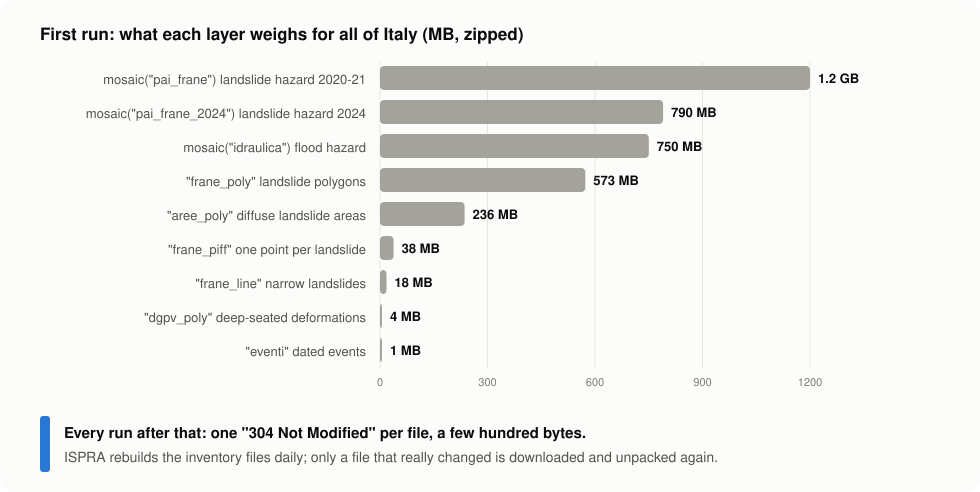
</p>

| You write | What it is | Italy, zipped | Licence |
|---|---|---|---|
| `opendata("frane_piff")` | IFFI landslides, one point each | 38 MB | CC BY-SA 4.0 |
| `opendata("frane_poly")` | IFFI landslide outlines (polygons) | 573 MB | CC BY-SA 4.0 |
| `opendata("frane_line")` | IFFI landslides too narrow for a polygon | 18 MB | CC BY-SA 4.0 |
| `opendata("aree_poly")` | areas with many small landslides | 236 MB | CC BY-SA 4.0 |
| `opendata("dgpv_poly")` | deep-seated slope deformations | 4 MB | CC BY-SA 4.0 |
| `opendata("eventi")` | dated landslide events (points) | 1 MB | CC BY-SA 4.0 |
| `opendata("segnalazioni")` | reports | small | not stated |
| `mosaic("pai_frane")` | PAI landslide hazard map v. 4.0, 2020-2021 (shapefile) | 1.2 GB | CC BY-SA 4.0 |
| `mosaic("pai_frane_2024")` | PAI landslide hazard map v. 5.0, **2024**, the newest (File Geodatabase) | 0.79 GB | **CC BY 4.0** |
| `mosaic("idraulica")` | flood hazard map 2020 | 0.75 GB | CC BY-SA 4.0 |
| `sensor_data()` | monitoring network readings, CSV (bzip2) | | |

Every `opendata` layer comes:

- for **Italy** (`area="ispra"`, the default), for one **region**
  (`REGIONS`, by ISTAT code: `REGIONS[16] == "puglia"`) or for a **province**
  that publishes on its own (`PROVINCES`: Bolzano, Trento, the nine Sicilian
  ones);
- as a **shapefile** (default) or **GeoJSON** (`fmt="geojson"`).

```python
opendata("frane_poly", "toscana")  # one region, shapefile
opendata("frane_piff", "trento", "geojson")  # one autonomous province, GeoJSON
opendata("eventi")  # all of Italy
```

Coordinates are in **EPSG:32632** (WGS 84 / UTM 32N), for every area. The
flood mosaic is the exception: **EPSG:3035** (ETRS89 / LAEA Europe).

<!-- --8<-- [end:download] -->

---

## Where downloads are saved

<!-- --8<-- [start:saved] -->

In a folder that should survive restarts, because the national files weigh
hundreds of MB:

1. the `directory` you pass to `fetch` or `download`;
2. otherwise `IDROGEO_DATA_DIR`, if set;
3. otherwise `~/.cache/ispra-idrogeo` (or `$XDG_CACHE_HOME/ispra-idrogeo`).

```text
~/.cache/ispra-idrogeo/
├── frane_piff_ispra_opendata.zip             # the download, kept to revalidate it
├── frane_piff_ispra_opendata.zip.meta.json   # URL, ETag, Last-Modified
└── frane_piff_ispra_opendata/                # unpacked, ready to read
    ├── frane_piff_opendataPoint.shp
    └── …
```

In **Docker**, point it at a volume so the data survives the container:

```yaml
services:
  app:
    environment:
      IDROGEO_DATA_DIR: /data/idrogeo
    volumes:
      - idrogeo-data:/data/idrogeo
volumes:
  idrogeo-data:
```

<!-- --8<-- [end:saved] -->

---

## A map for public bodies

<!-- --8<-- [start:app] -->

`app/` is the **Mappa dei dati su frane e pericolo**, a page in Italian for
the site of a municipality or another public body. It opens on a
municipality and shows what the official data says and how far to trust it:

- **on the map**: the landslide hazard areas of the 2024 PAI mosaic, flood
  hazard, the IFFI landslides, the dated landslides with how precise their
  date and place are, and the municipality's boundary;
- **in the panel**: a predisposition class for landslides and floods (the
  share of land in official hazard, in five fixed steps, **no rain, never an
  alert**), people and assets exposed, landslides by type, how far to trust
  the data there and what is not measured, the state of the contract with
  IdroGEO, sources, licences and downloads.

<p align="center">
  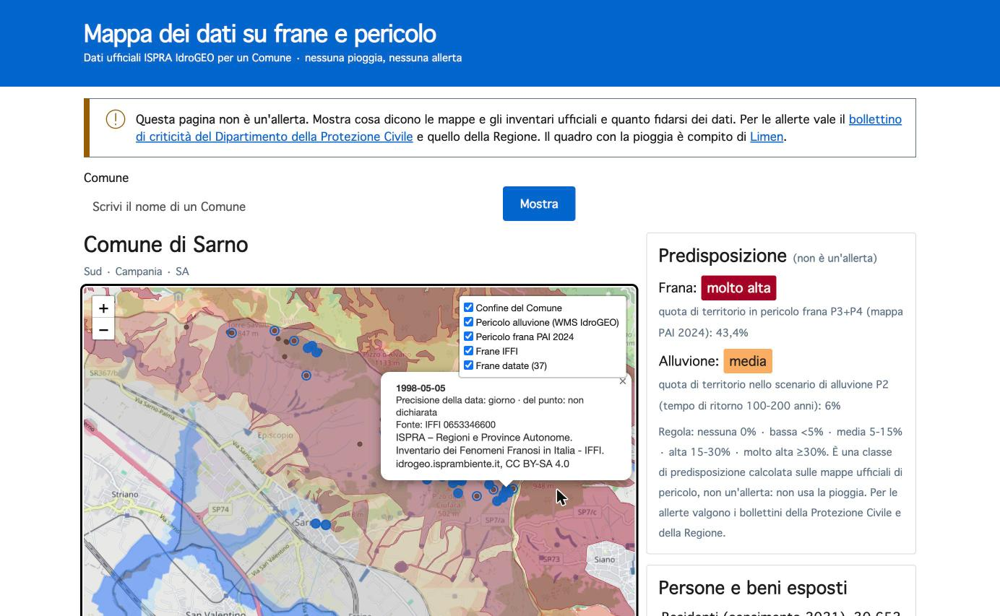
</p>

How the page works:

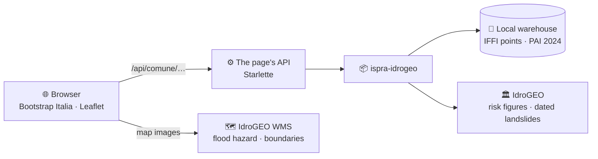

The predisposition class is the share of the town's land in official hazard,
in five fixed steps. This is how the 7,899 towns fall:

<p align="center">
  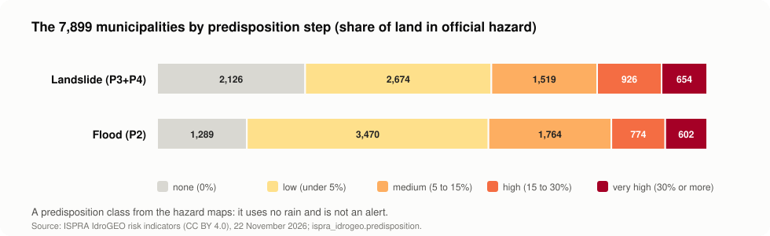
</p>

```bash
make app-up                                   # in Docker: http://localhost:3002 (container ispra-idrogeo-app)
IDROGEO_COMUNE=72006 IDROGEO_ENTE="Comune di Bari" make app-up
make app                                      # without Docker
```

It opens on Sarno (`?comune=<ISTAT>` or `IDROGEO_COMUNE` for another one).
At first start it loads the IFFI points and the 2024 mosaic into a local
DuckDB (about two minutes); meanwhile landslide hazard comes from IdroGEO's
WMS. Bootstrap Italia and Leaflet are served by the page itself, no CDN.

It reads no rain and gives no alert: the official alert is the bulletin of
the Civil Protection Department and of the region, and the picture that
joins rain, thresholds, landslides and hazard is
[Limen](https://github.com/agent-engineering-studio/limen)'s. How to reuse
it, in Italian: [`docs/riuso.md`](docs/riuso.md) and [`app/README.md`](app/README.md).
`publiccode.yml` is checked in CI for the Developers Italia catalogue.

<!-- --8<-- [end:app] -->

---

## Run it in containers

<!-- --8<-- [start:containers] -->

You need Docker and `make`. Nothing else: the images install Python and the
library for you.

```bash
make start                             # build every image and start everything: MCP, map, Jupyter
make stop                              # stop everything (downloads stay in a volume)
make up                                # the MCP server, on http://localhost:8767/mcp
make health                            # {"status":"ok",…}
make cli ARGS="hazard 40.829 14.617"   # any idrogeo command: P4, Sarno, 12.3°
make notebooks                         # Jupyter on http://localhost:8888/lab?token=idrogeo
make docker-test-notebooks             # run the test notebook inside a container
make down                              # stop (downloads stay in a volume)
make clean                             # stop and delete images and the volume
make help                              # every command
```

**Unique names.** Every container, image, volume and network starts with
`NAME` (by default `ispra-idrogeo`): `ispra-idrogeo-mcp`,
`ispra-idrogeo-notebooks`, `ispra-idrogeo-data`. So this project never
clashes with another one on the same computer. To run a second copy, give it
another name and other ports:

```bash
make up NAME=idrogeo-dev IDROGEO_MCP_PORT=8768   # idrogeo-dev-mcp on port 8768
make down NAME=idrogeo-dev
```

Defaults can also go in a `.env` file: copy `.env.example`. The ports listen
on this computer only (`127.0.0.1`). The images are built from this folder,
so they run the code you see.

<!-- --8<-- [end:containers] -->

---

## How it works

<!-- --8<-- [start:how] -->

### Download once, then only what changed

ISPRA rebuilds the inventory files **every day**
and sends an `ETag` and a `Last-Modified` with each one. The library
saves them next to the file and sends them back the next time: the server
answers `304 Not Modified` if the copy you have is still current.

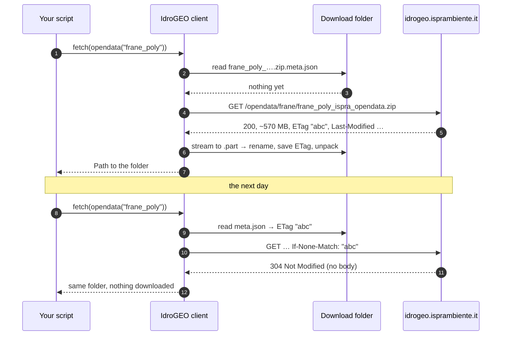

### What `fetch` decides

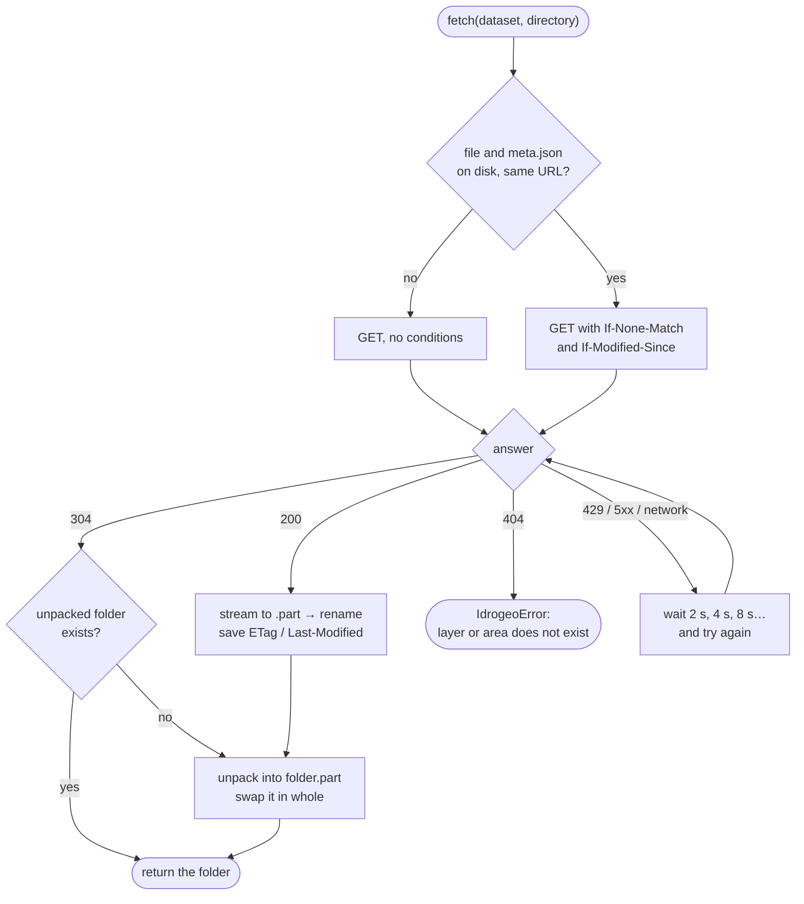

A reader never finds half a file or half a shapefile, and a ZIP member that
would land outside its folder (`../../etc/…`) is refused.

### The building blocks

The library has two layers. Use the high-level client, or call the pure
functions with any HTTP library you like.

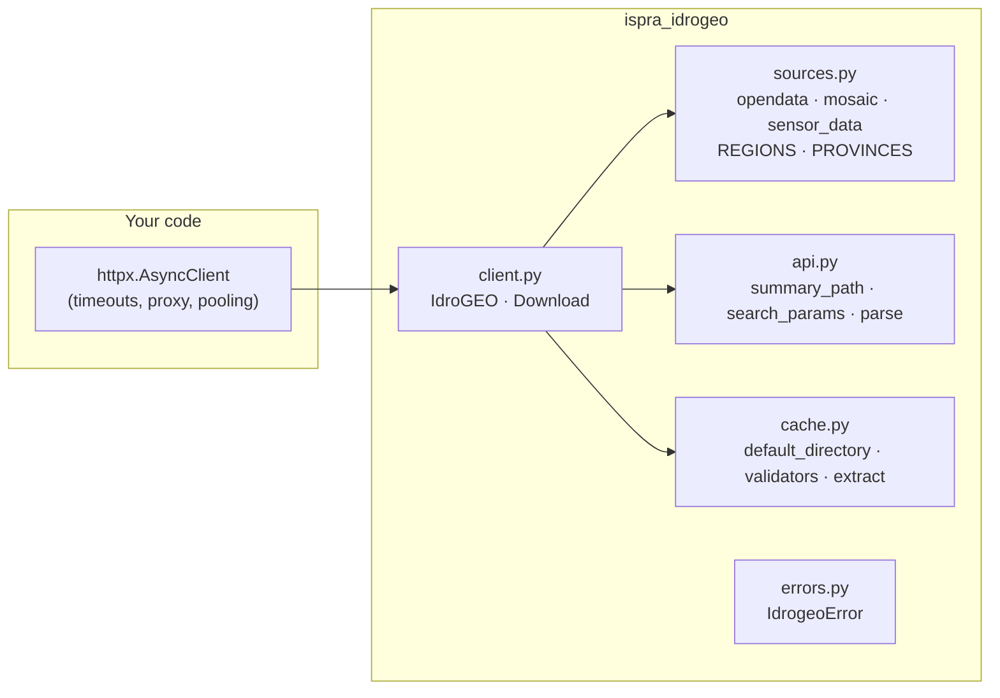

- **`sources.py`, `api.py`**: pure functions, no network. They build URLs and
  requests and read answers. Easy to test, easy to reuse.
- **`cache.py`**: the folder, the `.meta.json` validators and the safe unpacking.
- **`client.py`**: `IdroGEO` wires them to **your** `httpx.AsyncClient`.

<!-- --8<-- [end:how] -->

---

## Recipes

<!-- --8<-- [start:recipes] -->

### Keep a national copy fresh, every night

```python
from ispra_idrogeo import LANDSLIDE_LAYERS, IdroGEO, mosaic, opendata

async with IdroGEO() as idrogeo:
    for layer in LANDSLIDE_LAYERS:
        got = await idrogeo.download(opendata(layer))
        print(layer, "updated" if got.changed else "unchanged")
    for name in ("pai_frane", "idraulica"):
        await idrogeo.fetch(mosaic(name))
```

The first run downloads about 3 GB. Put it in a cron job: the following runs
cost a few kilobytes, plus whatever ISPRA really changed.

### Only what changed since last time

The nightly download above re-reads a whole file when anything in it
changed. To keep your own copy (a database, a GeoParquet file) up to date,
ask the API for the records changed since your last run instead:

```python
from datetime import UTC, datetime

from ispra_idrogeo import IdroGEO

since = datetime(2026, 11, 1, tzinfo=UTC)  # saved from your last run
async with IdroGEO() as idrogeo:
    changed = [f async for f in idrogeo.iter_landslides(modified_since=since, select=["*"])]
print(len(changed))  # 20 landslides changed in two days, with their geometry
next_since = max(datetime.fromisoformat(f["modified"]) for f in changed)
```

- Save the largest `modified` you received and pass it next time. The
  filter is "at or after", so the last record comes back once more: write
  by `id_frana` (upsert) and it does no harm.
- `select=["*"]` brings every field and the geometry: `geom` in EPSG:32632,
  `geom_polygon` / `geom_linestring` when there is one, `point` in lon/lat.
- `iter_events` and `sites` take `modified_since` too.
- **A removed landslide does not show up as changed**: it just stops being
  listed. Now and then, compare your ids with the full list, one call of
  about 15 seconds for 721,377 ids:

```python
ids = {f["id_frana"] async for f in idrogeo.iter_landslides(select=["id_frana"], page_size=100_000)}
```

### When did ISPRA last change each file?

```bash
idrogeo freshness                 # one HEAD per file: date, age, size, changed since last time
idrogeo freshness --summary       # {"files": 10, "changed": [...], "newest": ..., "oldest": ...}
```

```python
from ispra_idrogeo.freshness import freshness

async with IdroGEO() as idrogeo:
    for f in await freshness(idrogeo, state=Path("freshness.json")):
        print(f.filename, f.modified, f.age_days, f.changed)
# frane_piff_ispra_opendata.zip 2026-11-22T08:36:52Z 0 None      ← rebuilt this morning
# Mosaicatura_ISPRA_2024_pericolosita_frana_PAI.zip 2025-07-17T08:05:56Z 493 None
# Mosaicatura_ISPRA_2020_aree_pericolosita_idraulica.zip 2023-12-03T23:02:08Z 1084 None
```

Nothing is downloaded. With `state`, the previous answers are kept in a JSON
file, and `changed` says which files ISPRA changed since then (the first
time it is `None`). A nightly job can run it and download only those; the
MCP tool `data_freshness` tells an agent how recent the data behind an
answer is. The IFFI files are rebuilt every day, the mosaics every few
years.

### Watch for changes

```bash
idrogeo watch --once >> changes.jsonl                 # one round, e.g. every hour from cron
idrogeo watch --kind events --interval 900            # or keep running, every 15 minutes
```

Each line is a landslide, an event or a monitoring site that changed since
the previous round, with `"kind"` saying which. The first run starts from
now (or from `--since`); after that `<dir>/watch.json` remembers where each
kind stands, so a stopped watch resumes without missing or repeating a
change. In Python, `ispra_idrogeo.watch.changes(idrogeo, kind, mark)` does
one round.

### Landslides per region (the map above)

```python
from ispra_idrogeo import IdroGEO

async with IdroGEO() as idrogeo:
    for region in await idrogeo.summary("iffi", "regioni"):
        counts = await idrogeo.summary("iffi", "regioni", region["cod_reg"])
        hazard = await idrogeo.summary("pir", "regioni", region["cod_reg"])
        density = counts["frane_totali"] / hazard["ar_kmq"] * 100
        print(f"{region['nome']:<22} {counts['frane_totali']:>8,}  {density:5.0f} per 100 km²")
# Piemonte                 37,786    149 per 100 km²
# Valle d'Aosta             5,812    178 per 100 km²
# Lombardia               141,970    595 per 100 km²
# …
```

`summary("iffi", …)` gives landslide counts (also by type, in
`frane_stats`); `summary("pir", …)` gives hazard and risk indicators: areas,
residents, families, buildings, businesses and cultural heritage in each
landslide (`*_fr_*`) and flood (`*_idr_*`) hazard class. Levels are
`"italia"`, `"macroregioni"`, `"regioni"`, `"province"` and `"comuni"`, by
ISTAT code.

### Every municipality, in one table

```python
from datetime import timedelta

from ispra_idrogeo import IdroGEO

async with IdroGEO() as idrogeo:
    rows = await idrogeo.municipalities("pir", max_age=timedelta(days=30))
print(len(rows))  # 7899
worst = sorted(rows, key=lambda r: r["pop_fr_p3"] + r["pop_fr_p4"], reverse=True)[:3]
for r in worst:
    print(r["nome"], r["pop_fr_p3"] + r["pop_fr_p4"], f"{r['popfrp3p4p']:.1f} %")
# Napoli 42390 4.6 %     ← residents in landslide hazard P3 + P4, and their share
# Genova 30148 5.4 %
# Sanremo 14607 27.6 %
```

One call lists the municipalities, then one call each asks for its
indicators, 8 at a time: about a minute and 17 MB for all of Italy. Each
answer is saved as `<directory>/pir_comuni/<ISTAT code>.json`, so the next
run reads it back from disk (under two seconds), an interrupted run resumes
where it stopped, and `max_age` decides when an answer is old enough to ask
again. The indicators come from the 2020-2021 hazard mosaics and the 2021
census, so a monthly refresh is plenty.

`municipalities("iffi")` does the same with landslide counts, and
`summaries(summary, "regioni" | "province" | "comuni")` with any level.

### Translate the codes

The data stores codes (`tipo_movimento = 4`); the API has 73 code lists that
say what they mean, in Italian, English, French and German. `decode` adds a
`<field>_label` next to every coded field it knows:

```python
from ispra_idrogeo import IdroGEO, decode

async with IdroGEO() as idrogeo:
    labels = await idrogeo.code_labels(lang="en")  # one call per code list
    record = decode(await idrogeo.landslide("0017680500"), labels)
print(record["tipo_movimento_label"], "·", record["stato_attivita_1liv_label"])
# rapid debris flow · active/reactivated/suspended
```

It works on monitoring sites too (`strumentazione = [15, 22, 25]` becomes
`['inclinometer', 'topographic monitoring', 'Satellite SAR interferometry']`)
and on the rows of a shapefile, where the field is called `tipo_movim`.
`CODE_DICTIONARIES` lists which code list decodes which field, and
`labels("cause", "it")` gives one code list as `{code: label}`. A code that
is not in its list becomes `None` rather than a guess.

### Walk through every landslide or event

```python
from datetime import date

from ispra_idrogeo import IdroGEO, event_filter, landslide_filter

async with IdroGEO() as idrogeo:
    active_sinkholes = landslide_filter(movement=6, activity=100)
    print(len([f async for f in idrogeo.iter_landslides(active_sinkholes)]))  # 217

    tuscany_2023 = event_filter(region=9, start=date(2023, 1, 1), end=date(2024, 1, 1))
    async for event in idrogeo.iter_events(tuscany_2023):  # 8 events
        print(event["uid"], event["computed_date"], event["comune_nome"])
```

`iter_landslides` and `iter_events` ask for one page after another
(`page_size`, 1,000 by default) and stop at the last one. They sort by a
unique key (`id_frana`, `uid`) so pages do not overlap. An empty filter
matches everything. `search_landslides` and `search_events` return a single
page, if you prefer to page yourself.

Without `select`, a landslide search returns the fields in
`LANDSLIDE_FIELDS`: id, type, state, region, province, municipality,
position accuracy, the dates and `modified`. `select=["*"]` returns them all,
geometry included.

For the landslides of an area, `iter_landslides_in` checks each record's
own region, province or municipality, because the search has no reliable
area filter (see the traps). It reads the whole inventory with a few fields,
about 20 seconds for Italy, and gives the exact counts (Campania 55,254,
Sarno 53):

```python
async with IdroGEO() as idrogeo:
    sarno = [f async for f in idrogeo.iter_landslides_in(municipality=65135)]
    debris_flows = idrogeo.iter_landslides_in(region=15, filters=landslide_filter(movement=5))
```

`landslide_filter`, `event_filter` and `site_filter` build the filters, because each
search reads them its own way: landslides want `{"tipo_movimento": 6}` but
`{"stato_attivita_1liv": "eq.100"}`, events and sites want operators
everywhere, and a range of dates is an `"and"` of two conditions. Codes are
ISTAT codes for areas and the code lists' codes for the rest; a list of
codes means "any of these". You can still pass a plain `dict` if you know
the syntax.

### Dated landslides: when, and how precisely

A rainfall threshold can only be checked on landslides with a date.
`dated_landslides` gathers them from both places IdroGEO keeps them, the
IFFI records and the events file, each with the precision of its date and of
its place:

```python
from datetime import date

from ispra_idrogeo import IdroGEO
from ispra_idrogeo.dated import dated_landslides, summary

async with IdroGEO() as idrogeo:
    found = await dated_landslides(
        idrogeo,
        since=date(2018, 1, 1),
        max_interval_days=1,  # dates known to the day (or the hour)
        max_position_m=1000,  # points known to 1 km: events only, see below
    )
print(len(found), found[0].start, found[0].precision, found[0].position_m)
print(summary(found)["by_region"])
```

```bash
idrogeo dated --since 2018-01-01 --max-interval-days 1 --summary
idrogeo dated --source eventi --region 7 > liguria.jsonl
```

Each landslide has `start` and `end` (the day, or the interval it is known
within), `time` when one is written, `precision` (`hour`, `day`,
`interval`), `interval_days`, `position_m` (the stated accuracy of the
point, `None` when the source does not state it), `lon`/`lat` in degrees,
the area codes and its citation.

What the data holds (22 November 2026):

| | IFFI records | Events |
|---|---|---|
| Landslides | 721,457 | 1,808 |
| With a date | **28,076 (3.9%)**: 10,822 to the day, the rest an interval (6,491 within a month, 9,213 within a year, 1,550 longer) | 1,741 |
| Dated since 2018 | 2,216, of which 1,621 to the day | 1,710, all to the day; 521 with a time |
| Accuracy of the point | **not stated**: every record says `esatta` | exact 652 · 100 m 501 · 1 km 455 · 10 km 102 (since 2018) |

- **Most landslides have no date.** IFFI is mainly a map of *where*: 96% of
  its records have none, and a landslide without a date cannot validate a
  threshold.
- **The dated ones are not spread evenly.** Since 2018, 1,581 of the 3,331
  landslides dated to the day are in Trentino-Alto Adige. See
  [how far to trust the data](#how-far-to-trust-the-data-place-by-place),
  place by place.
- **Treat `00:00` as "that day".** Most dates have no time; `time` is `None`
  for them. For rainfall, take the whole day, better ±1 day for the time zone.
- **Uncertain dates can be a year or a month** (`"1979"`, `"1983-07"`): they
  become intervals. Impossible dates (year 7970) are left out.
- **An event and an IFFI record may be the same landslide**: the open-data
  events do not carry the IFFI id, so nothing here merges them.

### How far to trust the data, place by place

<!-- --8<-- [start:reliability] -->

IFFI is the best map of Italy's landslides, but it is not the same
everywhere. Some regions date many of their landslides and others none; some
were edited last year and others twenty years ago. `reliability` says which,
for any region, province or municipality, from a table shipped with the
package (no network):

```python
from ispra_idrogeo.reliability import reliability

sarno = reliability("comuni", 65135)
print(sarno.notes)
# ('14 of 53 IFFI landslides (26.4%) have a date to the day.',
#  '67.9% of the IFFI records were edited since 2021.',
#  'Since 2018: 0 IFFI landslides dated to the day and 2 events, 1 of them with a point known to 1 km.')
```

```bash
idrogeo reliability comuni 65135
idrogeo reliability regioni > regions.jsonl
```

Each answer has the landslides and their density per km², the share with any
date and with a date **to the day**, the landslides dated to the day since
2018 (IFFI, and events with how many points are known to 1 km), the share of
records **edited since 2021**, `notes` in plain words, and `not_measured`.
The MCP tool `data_reliability` gives the same to an AI agent.

<p align="center">
  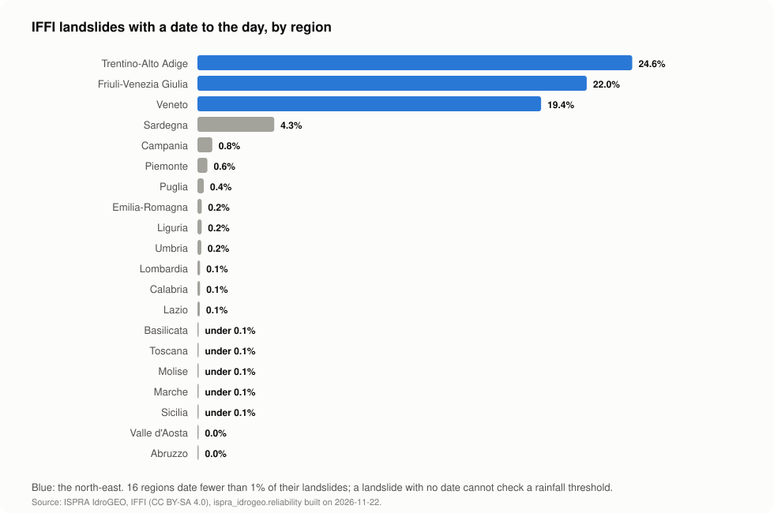
</p>

By region (22 November 2026), sorted by the share dated to the day:

| Region | IFFI landslides | per km² | dated | to the day | since 2018: IFFI · events | edited since 2021 |
|---|---:|---:|---:|---:|---:|---:|
| Trentino-Alto Adige | 25,301 | 1.86 | 57.7% | 24.6% | 1,395 · 186 | 61% |
| Friuli-Venezia Giulia | 5,822 | 0.73 | 36.3% | 22.0% | 0 · 64 | 0% |
| Veneto | 10,126 | 0.55 | 45.6% | 19.4% | 45 · 97 | 2% |
| Sardegna | 2,051 | 0.09 | 13.3% | 4.3% | 3 · 34 | 26% |
| Campania | 55,254 | 4.04 | 2.3% | 0.8% | 145 · 102 | 89% |
| Piemonte | 37,786 | 1.49 | 2.2% | 0.6% | 0 · 130 | 3% |
| Puglia | 839 | 0.04 | 4.8% | 0.4% | 0 · 2 | 0% |
| Emilia-Romagna | 80,337 | 3.57 | 0.5% | 0.2% | 1 · 307 | 0% |
| Liguria | 13,514 | 2.49 | 0.4% | 0.2% | 23 · 156 | 0% |
| Umbria | 34,566 | 4.08 | 0.6% | 0.2% | 1 · 18 | 0% |
| Lombardia | 141,970 | 5.95 | 0.2% | 0.1% | 4 · 235 | 0% |
| Calabria | 10,100 | 0.66 | 0.5% | 0.1% | 0 · 47 | 0% |
| Lazio | 10,550 | 0.61 | 0.2% | 0.1% | 2 · 64 | 0% |
| Basilicata | 17,671 | 1.75 | 0.2% | <0.1% | 0 · 14 | 0% |
| Toscana | 114,061 | 4.96 | 0.1% | <0.1% | 0 · 57 | 100% |
| Molise | 23,949 | 5.37 | <0.1% | <0.1% | 0 · 8 | 0% |
| Marche | 39,390 | 4.21 | <0.1% | <0.1% | 0 · 29 | 0% |
| Sicilia | 83,864 | 3.25 | <0.1% | <0.1% | 2 · 96 | 73% |
| Valle d'Aosta | 5,812 | 1.78 | 53.7% | 0.0% | 0 · 28 | 0% |
| Abruzzo | 8,494 | 0.78 | 0.0% | 0.0% | 0 · 36 | 0% |

What it shows:

- **Dates are a north-eastern thing.** Three areas (Trentino-Alto Adige,
  Friuli-Venezia Giulia, Veneto) date a fifth or more of their landslides to
  the day; sixteen regions date fewer than one in a hundred, seven fewer than
  one in a thousand. Valle d'Aosta dates half of them, but only to an
  interval.
- **Since 2018, the events matter more than IFFI** almost everywhere: outside
  Trentino-Alto Adige and Campania, IFFI has a handful of landslides dated
  to the day, the events file has tens or hundreds.
- **6,814 of the 7,899 municipalities have no landslide dated to the day
  since 2018**, and 2,276 have no IFFI landslide at all.
- **Density is not completeness.** Lombardia maps 5.95 landslides per km²,
  Puglia 0.04: geology explains part of it, the effort of each survey the
  rest, and nothing here can tell the two apart.

**Check:** the landslides counted per region are exactly the API's own
counts (`summary("iffi", "regioni")`, all 20), and the dated totals match
`dated_landslides` (28,076 IFFI records with a date, 10,822 to the day, 3,331
landslides dated to the day since 2018).

**What is not there:**

- the accuracy of IFFI positions: every record says `esatta`;
- how complete the inventory is: there is no reference to compare it with;
- when each region last surveyed its landslides: the open-data page says the
  year differs by region, but does not give it. "Edited since 2021" counts
  bulk loads too (117,282 records carry the placeholder date 2000-12-31,
  79,772 the migration of 18 July 2017): it says how recently the inventory
  was touched, not surveyed;
- whether an event and an IFFI record are the same landslide.

The table is rebuilt with `uv run python tools/build_reliability.py` (about
two minutes) and dated in `reliability_map().built_on`.

**For Limen:** `iffi_density_500` weighs IFFI the same everywhere. Sixteen
regions date fewer than 1% of their landslides to the day, so a backtest on
IFFI dates would test the north-east only; and a low density in Puglia or Sardegna is not proof of safety. See
limen#668.

<!-- --8<-- [end:reliability] -->

### One landslide, in full

```python
async with IdroGEO() as idrogeo:
    record = await idrogeo.landslide("0017680500")
print(len(record), record["stato"])  # 142 validato_ispra
# activations, causes, state and velocity, damage, interventions, precursors…
```

The full record of a validated landslide. Many fields are often empty, so
check before you rely on them. An unknown id raises `IdrogeoError` (IdroGEO
answers 401 to it, not 404).

### API rows on a map

`frame` turns API rows into a GeoDataFrame in the right coordinate system:

```python
from ispra_idrogeo.geo import frame

async with IdroGEO() as idrogeo:
    sites = frame(await idrogeo.sites())  # "point": lon/lat, EPSG:4326
    cams = frame(await idrogeo.webcams(), geometry="geom")  # EPSG:3857, as IdroGEO sends it
    changed = frame(
        [f async for f in idrogeo.iter_landslides(modified_since=since, select=["*"])],
        geometry="geom_polygon",  # or "geom" (point, EPSG:32632), "geom_linestring"
    )
```

### Who is watching a landslide: monitoring sites and webcams

```python
async with IdroGEO() as idrogeo:
    active = await idrogeo.sites({"stato_monitoraggio": "eq.1"})
    print(len(active))  # 558 of 1,063 sites are active
    site = active[0]
    print(site["uid"], site["point"], site["id_frane_correlati"])
    # SIABR001 [14.03, 42.24] ['0680013800']   ← lon/lat, and its IFFI landslides
    for station in await idrogeo.stations(site["uid"]):
        print(station["uid"], station["strumentazione"])

    cams = await idrogeo.webcams()  # 14, all in Lombardy
```

A **site** is a place where an agency (often an ARPA) monitors a landslide.
It has **stations**, and each station has **instruments** (inclinometers,
piezometers, rain gauges…, decoded by the `strumento_monitoraggio`
dictionary). `id_frane_correlati` links 880 sites to their IFFI landslides,
so you can tell which landslides someone is already watching. Look a site up
by its `uid` (`"SIPIE001"`), not by its `id`.

### Is this place at risk? Hazard at a point

```python
async with IdroGEO() as idrogeo:
    here = await idrogeo.hazard_at(40.829, 14.617)  # the hills above Sarno
print(here.landslide, here.flood, here.municipality_name, here.slope_deg)
# P4 None Sarno 12.3

async with IdroGEO() as idrogeo:
    venice = await idrogeo.hazard_at(45.438, 12.330)
print(venice.flood, venice.flood_scenarios)  # P3 ('P3', 'P2', 'P1')
```

One request, about a second, to IdroGEO's public map service: no 1.2 GB
mosaic to download. You get the PAI **landslide** class (`P4` very high,
`P3` high, `P2` medium, `P1` moderate, `AA` attention area), the **flood**
scenarios that reach the point (`P3` frequent floods, `P2` every 100–200
years, `P1` rare and extreme), the **municipality** (ISTAT code, ready for
`summary("pir", "comuni", code)`) and the **slope** in degrees.
`lithology=True` adds the rock type, but takes about 16 seconds more.

### Landslides near a point

```python
async with IdroGEO() as idrogeo:
    near = await idrogeo.landslides_near(40.838, 14.630, radius_m=500)
for f in near[:3]:
    print(f["id_frana"], f["nome_tipo"], f["nome_com"], f["distance_m"], f["shapes"])
# 0640689600 Colamento rapido Quindici 397.7 ['polygon', 'point']   ← a rapid debris flow
```

Every IFFI landslide within `radius_m` (up to 5 km), nearest first, with its
type and area, `distance_m` (0 when the point is on it) and the shapes it is
mapped as. The distance is computed from the real outline, not from a
centre point. Also: `idrogeo hazard 40.829 14.617` and `idrogeo near 40.838 14.630`.

### Offline, many places at once, your own SQL: a local warehouse

`hazard_at` asks the map service one point at a time. For thousands of
points, for work offline, or for questions of your own,
`pip install "ispra-idrogeo[warehouse]"` keeps the layers in one DuckDB file:

```bash
idrogeo sync frane_piff pai_frane idraulica   # once; then only what changed
idrogeo sql "SELECT nome_reg, count(*) AS n FROM frane_piff GROUP BY 1 ORDER BY n DESC"
idrogeo sql                                    # the tables and their columns
```

```python
from ispra_idrogeo.warehouse import Warehouse

async with IdroGEO() as idrogeo:
    with Warehouse() as warehouse:  # ~/.cache/ispra-idrogeo/idrogeo.duckdb
        await warehouse.sync(idrogeo, ["frane_piff", "pai_frane", "idraulica"])
        warehouse.hazard_at(40.8205, 14.6297)  # Sarno: {'landslide': 'P4', 'flood': None, …}
        warehouse.landslides_in(municipality=65135)  # Sarno: 53 landslides, by type
        warehouse.query(
            "SELECT p.class, count(*) AS landslides FROM frane_piff f "
            "JOIN pai_frane p ON ST_Intersects(p.geom, f.geom) "
            "WHERE f.regione = ? GROUP BY 1 ORDER BY 1",
            [14],
        )  # Molise, in 9 s: P4 2,904 · P3 8,242 · P2 569 · P1 2,377 · AA 659
        # (IFFI points by the class of the PAI polygons they fall in; a point in
        # two overlapping polygons counts twice)
```

`idrogeo sync pai_frane_2024` adds the 2024 landslide mosaic (a File
Geodatabase, read the same way): 1,060,084 polygons, downloaded and loaded in
132 s on 22 November 2026. Its areas match the API's indicators within 0.1%
per class (69,547 against 69,529 km²). When it is there, `hazard_at` takes
the landslide class from it and says so in `landslide_mosaic` (Sarno: P4).

`sync` downloads each layer only if it changed (as `fetch` does) and loads it
with an R-tree index, in one transaction: a failed load leaves the old table
in place. Every table is in EPSG:32632 metres, the flood mosaic reprojected
from EPSG:3035; `pai_frane` and `idraulica` carry a `class` column (`P4` …
`P1`, `AA`; `P3` … `P1`). Points go in as latitude and longitude, as in
`hazard_at`; geometries come out of `query` as WKT.

With the three national layers the file weighs 2.6 GB. Loading took 9 s for
the 721,377 landslide points, 55 s for the 928,542 landslide hazard polygons
and 9 minutes for the 85,460 flood polygons, whose reprojection is the slow
part; a point query then takes 10–40 ms. Checked on 4 November 2026: the
landslides counted per municipality match the API (Sarno 53, Casamicciola
Terme 213, Trivento 921), the points agree with `hazard_at` (Sarno P4, Venice
flood P3), and the flood areas add up to 16,283, 30,271 and 42,460 km² for P3,
P2 and P1, against the API's 16,224, 30,196 and 42,376 km².

`Warehouse(read_only=True)` opens the file for readers (the MCP server, a
notebook, `idrogeo sql`) and switches off DuckDB's access to files, URLs and
other databases, so SQL written by someone else, or by an agent, reads the
tables and nothing more. DuckDB downloads its `spatial` extension the first
time.

### Geology, aerial photos, bibliography

```python
async with IdroGEO() as idrogeo:
    units = await idrogeo.lookup("formazioni", "argille", limit=2)
    # [{'sigla': 'AAC', 'nome_unita': 'ARGILLE E ARENARIE GLAUCONITICHE DI CATENANUOVA', …}, …]
    flights = await idrogeo.lookup("voli", "1954")  # [{'id': '0001', 'nome': 'Volo GAI', …}]
```

The reference lists behind the landslide records, searched by text:
geological units (`formazioni`), aerial survey flights (`voli`),
bibliography (`bibliografie`), institutions (`istituzioni`), professional
bodies (`ordini`) and funding sources (`finanziamenti`). Ten answers by
default; `limit` asks for more. Also `idrogeo lookup formazioni argille`.

### For AI agents: the MCP server

<!-- --8<-- [start:mcp] -->

```bash
pip install "ispra-idrogeo[mcp]"
```

`idrogeo-mcp` is an [MCP](https://modelcontextprotocol.io) server, so Claude
Desktop, an IDE or your own agent can answer questions like *"how many people
live in high landslide hazard areas in Sarno, and is anyone monitoring the
landslides there?"* or *"is this address in a flood zone?"*. For Claude Desktop, add it to
`claude_desktop_config.json`:

```json
{
  "mcpServers": {
    "idrogeo": { "command": "idrogeo-mcp" }
  }
}
```

As an always-on service, for an agent that talks HTTP (for example
[mcp-geo-server](https://github.com/agent-engineering-studio/mcp-geo-server)'s
chat and map), serve it over streamable HTTP at `/mcp`:

```bash
idrogeo-mcp --transport streamable-http --host 0.0.0.0 --port 8767
```

Every option also reads an environment variable, so a compose file needs no
command line, and `GET /health` answers `{"status": "ok"}`:

```yaml
services:
  idrogeo-mcp:
    image: ghcr.io/astral-sh/uv:python3.12-bookworm-slim
    command: uvx --from "ispra-idrogeo[mcp]>=0.6" idrogeo-mcp
    environment:
      IDROGEO_MCP_TRANSPORT: streamable-http
      IDROGEO_MCP_HOST: 0.0.0.0
      IDROGEO_MCP_PORT: "8767"
      IDROGEO_DATA_DIR: /data/idrogeo  # for download_dataset
    volumes:
      - idrogeo-data:/data/idrogeo
    healthcheck:
      test: ["CMD", "python", "-c", "import urllib.request; urllib.request.urlopen('http://localhost:8767/health')"]
```

On `127.0.0.1` the SDK refuses requests with a foreign `Host` header (DNS
rebinding protection); on `0.0.0.0` it does not, unless you list the names
clients use: `IDROGEO_MCP_ALLOWED_HOSTS=idrogeo-mcp:*,localhost:*`.

| Tool | What the agent gets |
|---|---|
| `hazard_at` | Landslide and flood hazard, municipality and slope of a point |
| `landslides_near` | The landslides around a point, nearest first |
| `find_area` | The ISTAT code of a region, province or municipality from its name |
| `area_risk` | Hazard and exposure: residents, buildings, heritage per hazard class |
| `area_landslides` | IFFI counts by type of movement, events, monitoring |
| `landslide` | One landslide in full, codes decoded |
| `search_landslides` / `search_events` | Landslides by type and activity; events by area and date |
| `monitoring_sites` / `webcams` | Who is watching, with which instruments |
| `rank_areas` | The top (or bottom) regions, provinces or municipalities by any indicator, optionally inside a region or province |
| `compare_areas` | Up to 20 areas side by side, so the agent does not do arithmetic in its head |
| `code_list` | Any code list, in four languages |
| `download_dataset` | A layer downloaded (only if changed) to the local folder |
| `warehouse_schema` / `warehouse_sql` | The tables of the [local warehouse](#offline-many-places-at-once-your-own-sql-a-local-warehouse), and one read-only SQL query on them |
| `data_reliability` | How far IFFI counts and dates can be trusted in an area, with what is not measured |
| `data_freshness` | When ISPRA last changed each published file, and how many days ago |
| `check_answer` | The numbers of a draft answer that no tool returned: the agent checks itself before answering |

Names are matched without accents or apostrophes (`forli` finds *Forlì*),
and a name that matches nothing comes back with "did you mean" suggestions.

| Resource | What it holds |
|---|---|
| `idrogeo://indicators` | What `popfrp3p4p`, `pop_idr_p2` and the other indicator keys mean |
| `idrogeo://datasets` | The layers, mosaics and area names `download_dataset` accepts |
| `idrogeo://codes/{name}` | One code list, in English |

Two prompts, `area_profile` and `recent_events`, give a client ready-made
questions ("a risk profile of Sarno", "landslide events in Liguria since
October") that use the tools the right way and credit the source.

Every answer carries `source` (the citation and licence ISPRA asks for:
CC BY-SA 4.0 for IFFI and the events, CC BY 4.0 for the risk indicators)
and `retrieved_at` (UTC). Lists come as `{"results": […], "count": n,
"source": …, "retrieved_at": …}`. The instructions ask the agent to take
every number from a tool, to cite the source, and to call `check_answer` on
its draft.

Every tool but `download_dataset` only reads. Searches stop at `limit` rows
(100 by default, 1,000 at most), so an agent never receives 700,000
landslides at once, and IdroGEO's refusals come back as readable errors.
`rank_areas` keeps the summaries it reads on disk for 30 days: the first
national ranking of municipalities asks IdroGEO 7,899 times (a few minutes),
a region's ranking a few hundred.

<!-- --8<-- [end:mcp] -->

### Bring your own HTTP client

```python
import httpx

from ispra_idrogeo import IdroGEO

http = httpx.AsyncClient(timeout=httpx.Timeout(30, read=600), proxy="http://proxy:3128")
async with IdroGEO(http, retries=0) as idrogeo:  # your client, your retry policy
    ...
await http.aclose()  # the client is yours: IdroGEO does not close it
```

### Handle errors

```python
import httpx

from ispra_idrogeo import IdrogeoError

try:
    folder = await idrogeo.fetch(opendata("frane_piff", "puglia"))
except IdrogeoError as exc:
    # IdroGEO answered, but not with what was asked: 404, API refusal, not JSON.
    print("IdroGEO said no:", exc)
except httpx.HTTPError as exc:
    # Network problems still failing after the retries.
    print("network:", exc)
```

An unknown layer, area or mosaic name raises `ValueError` before any request.

<!-- --8<-- [end:recipes] -->

---

## Example notebooks

<!-- --8<-- [start:notebooks] -->

[`examples/`](https://github.com/agent-engineering-studio/ispra-idrogeo/tree/main/examples) has four notebooks. They were run on the live
service and keep their outputs.

| Notebook | What it does |
|---|---|
| **00 · Test the library** | Uses every feature once and checks the answer: downloads, the 304, events, risk figures, searches, hazard at a point, landslides nearby, monitoring, GeoDataFrames, the warehouse, the MCP server. Ends with a table of ✅ and ❌. |
| **01 · A town and its landslides** | Sarno, from its exposure figures to a map of its debris flows. |
| **02 · Italy in numbers** | Who lives in hazard areas, municipality by municipality. |
| **03 · What changed** | Following the inventory day by day. |

Run the test notebook to check that the library and IdroGEO still work
together (about a minute, small downloads):

```bash
make test-notebooks          # here, with uv
make docker-test-notebooks   # or inside a container
```

If a check fails, the command fails too.

<!-- --8<-- [end:notebooks] -->

---

## AI: where it helps

<!-- --8<-- [start:ai] -->

IdroGEO's data answers questions people really ask: *is my street in a flood
area? Which landslides are near this road? Who lives in high hazard in my
town?* An AI agent can answer them from the source, with numbers it can
cite, if it reads the data instead of guessing.

**The rule for every AI feature here: numbers come from the data, words from
the model.** The library computes every figure. A model may only choose
which tools to call and write sentences around the figures. It never makes
up a number, a date or a place. And nothing here is an alert.

### What is ready

| Piece | What it does | Needs an Anthropic key? |
|---|---|---|
| [`idrogeo-mcp`](#for-ai-agents-the-mcp-server) | Gives the data to any AI agent as 19 tools: hazard at a point, nearby landslides, risk figures, rankings, searches, SQL on the warehouse, and `check_answer`. Every answer carries its source, licence and time | No: the agent brings its own model (Claude Desktop, Claude Code, your app) |
| [`llms.txt`](https://agentengineering.it/ispra-idrogeo/llms.txt), [`llms-full.txt`](https://agentengineering.it/ispra-idrogeo/llms-full.txt), [`SKILL.md`](https://github.com/agent-engineering-studio/ispra-idrogeo/blob/main/skills/ispra-idrogeo/SKILL.md) | A short guide, the whole documentation in one file, and an agent skill for coding assistants, with the traps | No |
| [`check_text`](#check-a-text-for-invented-numbers) | Finds the numbers of a text that match no figure of the data it was written from. Also `idrogeo check` and the MCP tool `check_answer` | No |
| [`evals/`](https://github.com/agent-engineering-studio/ispra-idrogeo/tree/main/evals) | Measures whether Claude, connected to `idrogeo-mcp`, answers 31 real questions right. The true answers are computed from the live data on every run | **Yes** (paid calls) |

### Where it can help

| Who | Asks | What the agent does |
|---|---|---|
| A citizen | "Is my house in Sarno in a hazard area?" | `hazard_at` on the coordinates: P4 for landslides. It adds that a hazard map is not a safety assessment of a building |
| A municipal officer | "A risk profile of my town, compared with the province" | `find_area`, `area_risk`, `area_landslides`, `monitoring_sites`, `compare_areas` |
| A journalist | "The ten towns in Campania with the most people in landslide hazard" | `rank_areas`, so the ranking is computed and not done in the model's head |
| A researcher | "IFFI points by PAI class in Molise" | `warehouse_sql`, read-only SQL on the local copy |
| A developer | "Write a script that downloads Puglia's landslides" | reads `llms.txt` and uses the library the right way |
| [Limen](https://github.com/agent-engineering-studio/limen) | its assistant and briefings | the same tools, next to its own risk model |

### Where it must not be used

- **To decide hazard or send alerts.** Hazard comes from the PAI maps,
  alerts from the Civil Protection bulletins.
- **To fill gaps in the data.** A landslide without a date stays without a
  date. A model must not guess one, and such a landslide cannot be used to
  check a rainfall threshold.
- **To compute figures.** Sums, shares and rankings come from the tools.

### Check a text for invented numbers

```python
from ispra_idrogeo.grounding import check_text

facts = await idrogeo.summary("pir", "comuni", 72006)  # what the text was written from
check_text("Bari ha 315.948 residenti, l'1,3 % in pericolo alluvione P2.", facts)  # []
check_text("Bari has 315,949 residents.", facts)  # ['315,949']
```

```bash
idrogeo summary pir comuni 72006 > bari.json
echo "Bari has 315,949 residents." | idrogeo check bari.json   # exit 1: {"unmatched": ["315,949"], …}
```

A number passes when a figure of the facts, rounded the way the number is
written, equals it:

- `1.3 %` and `1,3 %` pass for 1.278;
- `1.3 million` and `1,3 milioni` pass for 1,278,455;
- a round number is read as rounded to its zeros, so `320,000` passes for
  315,948;
- `1,278` is read both ways, English (1278) and Italian (1.278).

Codes inside words (`P4`, `EPSG:32632`) and list markers are skipped. A date
must be among the dates of the facts. Numbers of the question are allowed
(`question=`).

**What it does not do.** It checks that a number exists in the facts, not
that it is said of the right thing. With all the indicators of Bari as
facts, "2 % in flood hazard P2" passes, because another indicator is 2.
Pass only the facts the text uses. A check of who-said-what
(`check_claims`) is not there yet.

### Use your Anthropic key

Only the agent eval calls a model, and only when you run it.

1. Get a key on [console.anthropic.com](https://console.anthropic.com/).
2. Copy `.env.example` to `.env` and write the key after
   `ANTHROPIC_API_KEY=`, without quotes.
3. Run a pilot of 5 questions, then all 31:

```bash
make eval ARGS="--limit 5"                           # a pilot (estimated $0.30–0.50)
make eval                                            # all 31 (claude-sonnet-5-5, effort medium)
make eval ARGS="--model claude-opus-5-5 --variant opus"   # another model, results kept apart
```

`make` reads the key from `.env` (or from your shell, or from `--api-key`).
The results go to `.claude/hillclimb/agent-mcp/<variant>/`, and `report.md`
gives the share of right answers by kind of question, the cost and the time.
A stopped run resumes where it stopped.

Keep the key safe:

- `.env` is in `.gitignore`: git never commits it. Never put the key in
  `.env.example`, which is committed.
- The library, the MCP server and the containers never read the key. Only
  `make eval` does.
- If a key leaks, revoke it on the console and make a new one.

### What comes next

These are planned in the roadmap
([#11](https://github.com/agent-engineering-studio/ispra-idrogeo/issues/11),
phase 5):

- ✅ **Source and date in every answer**, and ✅ **a checker for invented
  numbers** (`check_text`, `idrogeo check`, `check_answer`): done.
- **Who said what.** `check_claims`: a number said of the right indicator,
  not just present in the facts.
- **A faithfulness benchmark.** Answers written by a model from recorded
  facts, scored by `check_text` for free in CI; the model runs only by hand,
  with a key.
- **Area reports.** `idrogeo report <comune>`: the figures from a template
  with no model at all; with a key, a model writes a plain summary, and the
  checker verifies it before it is saved.
- **Change digests** on top of `idrogeo watch` and `idrogeo freshness`.
- ✅ An agent skill (`SKILL.md`) and `llms-full.txt`: done.

<!-- --8<-- [end:ai] -->

---

## The traps we already fell into

<!-- --8<-- [start:traps] -->

IdroGEO works well, but its older documentation and many scripts on the web
point to paths that no longer exist. This library handles these for you:

| You try | What actually happens | What ispra-idrogeo does |
|---|---|---|
| `/opendata/iffi/<region>/iffi_<region>_<layer>.zip`, as in older guides | HTTP **404** in 2026: the files moved | uses `/opendata/frane/<layer>_<area>_opendata.zip` |
| the dictionaries in `/opendata/iffi/dizionari/*.json` | HTTP **404**: they moved to the API | reads `/api/dizionari` |
| the WFS at `geoserver/idrogeo/frane/ows` | HTTP **401**: the WFS needs a login | reads features through the **WMS**, which is public: `GetFeatureInfo` on 101 queryable layers |
| asking the WMS about a point with a 1×1 image or the point as the box | nothing, or the wrong pixel | a ~2 m box around the point and its middle pixel (`i=50`, `j=50`), lat,lon order as WMS 1.3.0 wants |
| the lithology layer next to the hazard layers | ~16 s for the whole answer, against under one second without it | `hazard_at(..., lithology=False)` by default |
| the slope at sea | `-9999.0` | `slope_deg = None` |
| a file for `trentino-alto-adige` | there is none: it publishes per province | offers `bolzano` and `trento` in `PROVINCES` |
| downloading the inventory again every day "to be safe" | ~870 MB a day, whether anything changed or not | conditional GET: one `304` when nothing changed |
| `/api/evento/{id}`, which the OpenAPI lists with no login | HTTP **401** without a login (`/api/frana/{id}` does answer 200) | reads events through `search_events`, which is public |
| `/api/frana/{id}` with an id that does not exist | HTTP **401** "Missing authorization header", not 404 | raises `IdrogeoError`: unknown or not public |
| `/api/sito/{id}` with the site's `id` (a UUID) | HTTP **404**: the path wants the `uid` (`SIPIE001`); `/listing` of an unknown site answers `null` with HTTP 200 | `site(uid)` and `stations(uid)`, which raise `IdrogeoError` for both |
| webcam `geom` as longitude and latitude | it is **EPSG:3857** metres, while sites use lon/lat | says so in `webcams()` |
| a webcam's `timelapse_url` | HTTP **404** or a redirect to the web app: the videos are not published | leaves the field as IdroGEO sends it |
| `{"tipo_movimento": "eq.6"}` on landslides, like every other field | `invalid input syntax for type integer`: this one field wants a plain `6`, and no list | `landslide_filter(movement=6)` |
| landslides of a region, `{"regione": "eq.16"}` | `not an embedded resource`; `regione_2019`, which does filter, is **empty for 18%** of the landslides, and `regione_orig` is worse (Campania: 19,710 and 6,224 of 55,254) | `iter_landslides_in(region=15)` checks the record's own `regione`, which is always set: 55,254 |
| paging the whole inventory 100,000 at a time | each page slower than the last (2.5 s at offset 0, 6.7 s at 600,000), and `id_frana` takes no `gt.` for keyset paging | one page of a million rows for area scans: ~20 s for Italy |
| a landslide search without `select` | HTTP **400** since November 2026: "Could not find a relationship between 'idrogeo_frane' and 'regioni_2022'" (the search's default fields embed a relation IdroGEO removed) | always names the fields: `LANDSLIDE_FIELDS` by default, `select=["*"]` for all |
| `accuratezza_posizione` of IFFI records, to keep the precise ones | it is **`esatta` for all 721,457**: it tells nothing | `dated_landslides` gives IFFI `position_m = None` (not stated) |
| uncertain dates as days | `data_incerta_min`/`max` can be a bare year (`"1979"`) or month (`"1983-07"`), and a few dates are impossible (year 7970) | `parse_period` reads them as intervals and leaves impossible ones out |
| `for name in MOSAICS: fetch(mosaic(name))` to get "the" mosaics | since 0.9.0 `MOSAICS` also holds `pai_frane_2024`: such a loop downloads 790 MB more than before (Limen's tests caught it, limen#673) | name the mosaics you need: `mosaic("pai_frane")`, `mosaic("idraulica")`; new ones are added as ISPRA publishes them |
| several landslides by id, `{"id_frana": "in.(…)"}` | an empty list, no error | `landslide(id)` for each one |
| reading the shapefile while a new version is unpacking | half a shapefile, or a crash | unpacks beside it and swaps the folder in whole |
| the flood mosaic in UTM 32N, like everything else | it is in **EPSG:3035** (ETRS89 LAEA), in three files, one per scenario (`HPH_`, `MPH_`, `LPH_`) | the warehouse reprojects it and names the scenarios P3, P2, P1 |
| reading the IFFI shapefiles as UTF-8 | `Invalid unicode`: the text is **ISO-8859-1**, said in a `.cst` file that GDAL ignores (it reads `.cpg`) | the warehouse reads the `.cst` and passes the encoding |
| IFFI and the mosaics under CC BY 4.0, ISPRA's default | IdroGEO's licence PDFs say **CC BY-SA 4.0** for the IFFI inventory (one PDF per region) and for the 2020-2021 landslide and 2020 flood mosaics, each with its own citation; the 2024 landslide mosaic and the risk indicators are CC BY 4.0 | `warehouse.SOURCES` holds each citation, and the answers carry their licence |
| the API's landslide hazard areas to add up like the 2020-2021 mosaic | that mosaic (v4.0) adds up to ~60,500 km² (P4 9,506 · P3 16,894 · P2 14,553 · P1 12,558 · AA 6,988), the API's `ar_fr_*` to 69,529 km². The API uses the **2024 mosaic** (v5.0): it adds up to 69,547 km², within 0.1% per class (P4 10,609 · P3 18,206 · P2 18,076 · P1 15,491 · AA 7,165). The flood areas match | offers `mosaic("pai_frane_2024")`, which the warehouse prefers for `hazard_at` |

All checked against the live service on 3–4 November 2026, and again every
day by `tests/live/` (`make live`): if IdroGEO changes one of these, the
`live` workflow opens an issue.

<!-- --8<-- [end:traps] -->

---

## Known cases

<!-- --8<-- [start:benchmark] -->

A library that reads someone else's data is only as good as its last check
against that data. `benchmarks/` holds places and events whose answer is
known, and checks the library against them on every pull request, offline:

| case | check | ispra-idrogeo | constant |
|---|---|---|---|
| sarno | the hills above the town are in landslide hazard P4 | ✅ | ❌ |
| sarno | IFFI landslides of Sarno | ✅ | ❌ |
| sarno | landslides mapped within 500 m of the slope above Episcopio | ✅ | ❌ |
| venice | San Marco is in flood hazard P3, no landslide hazard | ✅ | ❌ |
| foggia | a point of the plain is outside every hazard area | ✅ | ❌ |
| casamicciola-2022-11-26 | the event of 26 November 2022 is recorded | ✅ | ❌ |
| casamicciola-2022-11-26 | IFFI landslides of Casamicciola Terme | ✅ | ❌ |
| melito-2026-10-10 | the town is in landslide hazard P2 | ✅ | ❌ |
| melito-2026-10-10 | IFFI landslides of Melito di Porto Salvo | ✅ | ❌ |
| melito-2026-10-10 | no landslide event recorded for the storm (yet) | ✅ | ✅ |
| trivento | IFFI landslides of Trivento | ✅ | ❌ |
| contract-select | a search with no select still answers | ✅ | ⚠️ error: HTTPStatusError |
| reliability | Trentino-Alto Adige dates a fifth of its landslides to the day | ✅ | ❌ |
| reliability | Abruzzo dates none | ✅ | ❌ |
| **score** | | confirmed: 11/11 · known-gap: 3/3 | confirmed: 0/11 · known-gap: 1/3 |

- **`ispra-idrogeo`** is the library, used as a user would. **`constant`**
  gives the same answer everywhere (P4 and P3, nothing counted, a search
  with IdroGEO's default fields): it shows that each check can tell a right
  answer from a wrong one. It passes only "no event yet" at Melito, because
  it always answers "no event".
- **`known-gap`** records something IdroGEO does not have yet: the storm of
  10 October 2026 at Melito di Porto Salvo (152 mm of radar rain) has no
  landslide event on 22 November 2026. When ISPRA adds it, the check fails
  and the case is updated on purpose.
- **`contract-select`** keeps the lesson of #9: IdroGEO's own answer to a
  search with its default fields (a 400) is in the recording, and the
  library must not depend on it.

How it works: `python -m benchmarks.record` runs each case once against the
live service and keeps IdroGEO's real answers in `benchmarks/cassettes/`
(260 kB of JSON, the answers only). `python -m benchmarks.run --check`
replays them with no network and compares the outcome of every check with
`benchmarks/results.json`; any difference fails CI. A request the
recording has not seen fails too, so a change in what the library asks for
cannot slip through as a silent call to the network.

```bash
make benchmark          # the table, offline, as in CI
make benchmark-record   # re-record from the live service, then look at what changed
```

**What is not there.** The recordings are a snapshot of 22 November 2026:
they prove the library reads those answers right, not that IdroGEO still
gives them. The daily live contract tests (`make live`) watch the service
itself. The cases are few (8 cases, 14 checks); more are welcome, each with a
source.

**For Limen:** a fixed set of places where its hazard and count inputs must
give the known answer, and a recorded gap (Melito) to watch for.

<!-- --8<-- [end:benchmark] -->

---

## API at a glance

<!-- --8<-- [start:api] -->

| Name | What it does |
|---|---|
| `IdroGEO(client=None, *, retries=3, backoff_s=2.0)` | The async client; opens (and closes) its own HTTP client if not given one. |
| `.fetch(dataset, directory=None, *, unpack=True)` | The dataset ready to read: the unpacked folder, or the file. |
| `.download(dataset, directory=None)` | `Download(path, changed)`: the file, and whether this call changed it. |
| `.summary(summary, level, code=None)` | `"iffi"` counts or `"pir"` indicators; without `code`, the list of that level. |
| `.dictionaries()` / `.dictionary(name)` | The names of the code lists / one list. |
| `.landslide(id_frana)` | The full record of one validated landslide. |
| `.iter_landslides(filters, modified_since=, page_size=1000, select=, order="id_frana")` | Every matching IFFI landslide, page after page; only the changed ones with `modified_since`. |
| `.iter_events(filters, modified_since=, page_size=1000, select=, order="uid")` | Every matching landslide event, page after page. |
| `.sites(filters, modified_since=, select=)` | The monitoring sites (1,063). |
| `.site(uid)` / `.stations(uid)` | One site / its stations, instruments and sensors. |
| `.webcams(filters)` | The webcams pointed at landslides. |
| `.iter_landslides_in(region=, province=, municipality=, filters=, select=)` | Every landslide of an area, checked on the record's own area fields. |
| `.search_landslides(filters, limit=, offset=, select=, order=)` | One page of IFFI landslides. |
| `.search_events(filters, limit=, offset=, select=, order=)` | One page of validated landslide events. |
| `.municipalities(summary="pir", directory=None, *, concurrency=8, max_age=None, region=None, province=None)` | The summary of all 7,899 municipalities (or those of a region or province), saved one JSON per municipality. |
| `.summaries(summary, level, directory=None, *, concurrency=8, max_age=None)` | The same for every region, province or municipality. |
| `opendata(layer, area="ispra", fmt="shapefile")` | An open-data `Dataset` (URL + file name). |
| `mosaic("pai_frane" \| "idraulica")` | A national hazard mosaic. |
| `sensor_data()` | The monitoring network readings. |
| `REGIONS` / `PROVINCES` / `region_area(cod_reg)` | Area file names by ISTAT code. |
| `LANDSLIDE_LAYERS` / `EVENT_LAYERS` / `MOSAICS` | What there is. |
| `LANDSLIDE_FIELDS` | The fields a landslide search returns when you give no `select`. |
| `default_directory()` | Where downloads go when no directory is given. |
| `.hazard_at(lat, lon, lithology=False)` | `PointHazard`: landslide class, flood scenarios, municipality, slope. |
| `.landslides_near(lat, lon, radius_m=500, limit=200)` | IFFI landslides around a point, with `distance_m`. |
| `.lookup(kind, text, limit=10)` | Search geological units, flights, bibliography, institutions, funding. |
| `IdrogeoError` | IdroGEO answered, but not with what was asked for. |
| `ispra_idrogeo.dated.dated_landslides(idrogeo, since=, until=, region=, max_interval_days=, max_position_m=, sources=)` | Dated landslides of IFFI and of the events, with the precision of date and place; `summary(found)` counts them. |
| `.head(dataset)` / `ispra_idrogeo.freshness.freshness(idrogeo, datasets=None, state=None)` | A file's date, ETag and size without downloading it; every file's freshness and whether it changed since the saved state. |
| `ispra_idrogeo.predisposition.predisposition(summary)` | The landslide and flood predisposition classes of an area from its `summary("pir", …)`: five fixed steps on the official share of land in hazard, no rain. |
| `ispra_idrogeo.reliability.reliability(level, code)` | How far IFFI and the events can be trusted in an area: dates, events since 2018, upkeep, notes, what is not measured. |
| `ispra_idrogeo.grounding.check_text(text, facts, question="")` | The numbers and dates of a text that match no figure of `facts`. |
| `ispra_idrogeo.grounding.grounded(answer, kind)` / `SOURCES` | An answer with its `source` and `retrieved_at`; the citation and licence of each kind of data. |
| `.labels(name, lang)` / `.code_labels(fields, lang)` / `decode(record, labels)` | Code lists, and records with `<field>_label` added. |
| `ispra_idrogeo.geo.read(path)` | A downloaded file or folder as a GeoDataFrame (extra `[geo]`). |
| `ispra_idrogeo.geo.frame(rows, geometry="point")` | API rows as a GeoDataFrame, in their own CRS. |
| `ispra_idrogeo.geo.add_labels(frame, labels)` | `<column>_label` columns for coded columns. |
| `ispra_idrogeo.warehouse.Warehouse(path=None, *, read_only=False)` | A local DuckDB copy of the layers (extra `[warehouse]`). |
| `.sync(idrogeo, layers, area="ispra")` | Download (if changed) and load the layers that changed. |
| `.query(sql, params, limit=1000)` / `.schema()` | One read-only SELECT / the tables and columns. |
| `.hazard_at(lat, lon)` / `.landslides_near(lat, lon, radius_m)` / `.landslides_in(...)` | The same questions as the client's, answered offline. |
| `.download` / `.fetch(..., progress=callback)` | `callback(done, total)` after each chunk, for your own progress bar. |
| `ispra_idrogeo.watch.changes(idrogeo, kind, mark)` | One round of `idrogeo watch`: what changed since a `Mark`. |
| `idrogeo-mcp` | An MCP server with the same data as 19 tools, 3 resources and 2 prompts (extra `[mcp]`). |
| `idrogeo <command>` | The same from the shell: `fetch`, `summary`, `municipalities`, `landslides`, `events`, `sites`, `webcams`, `landslide`, `labels`, `dictionaries`, `lookup`, `hazard`, `near`, `watch`, `sync`, `sql`, `check`, `dated`, `reliability`, `freshness`. |

Lower level, for your own HTTP layer: `summary_path`, `search_params`,
`level_codes`, `since_filter`, `parse` / `parse_list`, `read_validators` / `write_validators`,
`read_json` / `write_json`, `extract`.

<!-- --8<-- [end:api] -->

---

## Contributing

Contributions of every size are welcome, from a typo to a new feature. You
don't need to be a geologist: most of the code is plain Python, HTTP and
files.

```bash
git clone https://github.com/agent-engineering-studio/ispra-idrogeo
cd ispra-idrogeo
uv sync          # install everything, dev tools included
make check       # ruff + mypy --strict + pytest, the same gate as CI
make help        # every other command
```

The tests **need no network**: they run against a mocked transport
(`httpx.MockTransport`), so they are fast and never hit ISPRA's servers.

```text
ispra-idrogeo/
├── src/ispra_idrogeo/
│   ├── sources.py   # where the open data lives: pure URL builders
│   ├── api.py       # REST API requests and parsers
│   ├── cache.py     # the persistent folder, ETag/Last-Modified, safe unzip
│   ├── client.py    # IdroGEO: async client, retries, streaming
│   └── errors.py    # IdrogeoError
├── docs/
│   ├── make_figures.py  # redraws docs/images/ from the live API
│   └── images/          # the figures of this README
└── tests/
```

How to propose a change:


Rules are short: see [CONTRIBUTING.md](./CONTRIBUTING.md). Commits follow
[Conventional Commits](https://www.conventionalcommits.org/), coverage stays
above 90%, and contributions are accepted under Apache-2.0.

### Ideas to work on

<!-- --8<-- [start:ideas] -->

Not promises, just directions where help would make a difference. Open an
issue to discuss one before starting. The
[Roadmap & AI](https://agentengineering.it/ispra-idrogeo/roadmap/)
page has the longer analysis, AI features included.

| Idea | Why it matters | Good for |
|---|---|---|
| 📏 **How far to trust the data**: date, position and completeness of IFFI, region by region ([#11](https://github.com/agent-engineering-studio/ispra-idrogeo/issues/11)) | Rainfall thresholds can only be checked on landslides with a date | intermediate |
| 🧠 **An agent evaluation suite**: questions with checked answers, run against `idrogeo-mcp` | Tool descriptions are prompts: test them like code | intermediate, AI users |
| 🧩 **A GeoServer bootstrap** that publishes the downloads, for [mcp-geo-server](https://github.com/agent-engineering-studio/mcp-geo-server) | From open data to a live map server in one command | advanced |
| 📚 **Tutorials on the [documentation site](https://agentengineering.it/ispra-idrogeo/)** | Search and API reference are there; step-by-step guides are not yet | anyone |

Found something odd in IdroGEO? That is a contribution too: open an issue
with what you sent and what came back.

<!-- --8<-- [end:ideas] -->

---

## Data licence and credits

<!-- --8<-- [start:licence] -->

The data is ISPRA's, not ours. Each dataset has its own licence, stated on
IdroGEO's [open-data page](https://idrogeo.isprambiente.it/app/page/open-data)
and in its licence PDF (checked on 22 November 2026):

| Data | Licence | How to cite it |
|---|---|---|
| IFFI landslides (`frane_*`, `aree_poly`, `dgpv_poly`) and events (`eventi`) | [CC BY-SA 4.0](https://creativecommons.org/licenses/by-sa/4.0/legalcode) | ISPRA – Regione *name*. Inventario dei Fenomeni Franosi in Italia - IFFI. idrogeo.isprambiente.it |
| Landslide hazard mosaic 2024 (`pai_frane_2024`, v. 5.0) | CC BY 4.0 | ISPRA - Mosaicatura nazionale delle aree a pericolosità da frana PAI (v. 5.0 – 2024) – Piattaforma IdroGEO https://idrogeo.isprambiente.it |
| Landslide hazard mosaic (`pai_frane`, v. 4.0, 2020-2021) | CC BY-SA 4.0 | ISPRA - Mosaicatura nazionale delle aree a pericolosità da frana PAI (v. 4.0 – 2020-2021), https://idrogeo.isprambiente.it |
| Flood hazard mosaic (`idraulica`, v. 5.0, 2020) | CC BY-SA 4.0 | ISPRA - Mosaicatura delle aree a pericolosità idraulica (v. 5.0 – 2020), https://idrogeo.isprambiente.it |
| Risk indicators (`summary("pir", …)`, `municipalities`) | [CC BY 4.0](https://creativecommons.org/licenses/by/4.0/legalcode) | ISPRA (2024) Pericolosità e indicatori di rischio frane – Piattaforma IdroGEO; ISPRA (2020) Pericolosità e indicatori di rischio alluvioni – Piattaforma IdroGEO |
| Monitoring sites | CC BY 4.0 | ISPRA — IdroGEO |
| Everything else from ISPRA, unless stated | CC BY 4.0 ([note legali](https://www.isprambiente.gov.it/it/note-legali)) | ISPRA — IdroGEO |

What this means for you:

- **Always credit the source.** `ispra_idrogeo.warehouse.SOURCES` holds the
  citations above.
- **Share-alike.** Data you derive from IFFI, the events, the 2020-2021
  landslide mosaic or the flood mosaic must be shared under CC BY-SA 4.0 too
  (the 2024 landslide mosaic is CC BY 4.0). The code that processes it can keep its
  own licence.
- The IFFI licence is per region: the citation names the region the data
  comes from.

ISPRA adds that the mosaics are technical and scientific works updated every
few years: the maps with legal value are those of the basin district
authorities and of the provinces of Trento and Bolzano. For new work,
prefer the 2024 landslide mosaic (`pai_frane_2024`): it is newer, it is the
one the API's risk indicators are computed on, and it is CC BY 4.0, not
share-alike.

**A hazard map is not an alert.** For warnings, follow the bulletins of the
Civil Protection Department and of your region.

This library only downloads the data. The figures in this README are drawn
from IdroGEO API answers of 3 November 2026 (redraw them with
`uv run python docs/make_figures.py`); the region map is a schematic tile
map, not a geographic one.

Code: [Apache-2.0](https://github.com/agent-engineering-studio/ispra-idrogeo/blob/main/LICENSE). Extracted from
[Limen](https://github.com/agent-engineering-studio/limen).

If this project is useful to you, a ⭐ on GitHub helps others find it.

<!-- --8<-- [end:licence] -->
