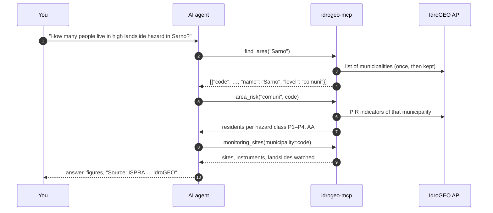

# AI agents

IdroGEO's data answers questions people actually ask: *is my town in a
flood zone? How many landslides are there in this valley? Is anyone watching
the one above the road?* `idrogeo-mcp` lets an AI agent answer them from the
source, with numbers it can cite, instead of from memory.

## The MCP server

--8<-- "README.md:mcp"

## How an agent uses it

A typical question takes three or four tool calls. The agent turns a name into
an ISTAT code, then reads the figures for that code:



## Other clients

The server speaks MCP over stdio, so any MCP client can start it.

=== "Claude Code"

    ```bash
    claude mcp add idrogeo -- idrogeo-mcp
    ```

=== "Claude Desktop"

    ```json
    {
      "mcpServers": {
        "idrogeo": { "command": "idrogeo-mcp" }
      }
    }
    ```

=== "Without installing (uvx)"

    ```json
    {
      "mcpServers": {
        "idrogeo": {
          "command": "uvx",
          "args": ["--from", "ispra-idrogeo[mcp]", "idrogeo-mcp"]
        }
      }
    }
    ```

## Questions to try

- *Which province of Liguria has the largest share of residents in flood hazard P3?*
- *Which landslide monitoring sites are active in the province of Belluno, and with which instruments?*
- *Compare landslide hazard exposure (P3 + P4) of Sarno, Ischia and Casamicciola Terme.*
- *What do the movement codes 1, 2 and 6 mean, in Italian and in English?*
- *Download the Molise landslide points and tell me where the folder is.*

!!! warning "Answers are information, not a safety assessment"
    PAI hazard maps and the IFFI inventory are official, but an agent's
    summary of them is not. For decisions about a building, a site or an
    emergency, refer to the competent basin authority, region or civil
    protection service.

## For coding assistants: `llms.txt`

This site publishes [`llms.txt`](llms.txt), a short plain-text guide to the
library for AI coding assistants: what to call, in which order, and the traps
to avoid. Point your assistant at
`https://agentengineering.it/ispra-idrogeo/llms.txt`.
