# Roadmap & AI

An analysis of where ispra-idrogeo stands at **0.5.0** (November 2026), and of
the improvements and AI features that would make it more useful. These are
directions, not promises: open an issue to discuss one before starting.

## Where we are

| Area | Today | Gap |
|---|---|---|
| **Downloads** | Every open-data layer and mosaic, conditional GET, atomic swap | No progress feedback on the 1.2 GB mosaic |
| **REST API** | Summaries, searches, sites, webcams, code lists, lookups | No reliable *area* filter for landslides (`regione_2019` is empty for 18%) and no *spatial* query at all |
| **Geo** | GeoDataFrames, GeoParquet, labels | No local, indexed copy to query: every analysis starts by reading shapefiles |
| **AI agents** | `idrogeo-mcp`: 10 tools, stdio, decoded codes, row caps | Agents cannot answer "is *this address* at risk?"; no MCP resources or prompts; no remote transport; untyped tool outputs |
| **Quality** | `mypy --strict`, 100% coverage, mocked transport | Nothing notices when ISPRA moves a path again (see [Known traps](traps.md)) |

The single biggest limit, for people and agents alike, is the **missing spatial
query**. Almost every AI feature below gets better once it exists, so it comes
first.

## The plan at a glance

```mermaid
flowchart LR
    subgraph F["① Foundations"]
        direction TB
        W["Local warehouse<br/>GeoParquet + DuckDB"]
        P["Point & area queries<br/>hazard_at · near"]
        C["Live contract tests"]
    end
    subgraph M["② Better MCP"]
        direction TB
        T["New tools<br/>hazard_at_point · nearest_landslides<br/>rank_areas"]
        R["Resources & prompts"]
        H["Streamable HTTP<br/>typed outputs · citations"]
    end
    subgraph A["③ AI features"]
        direction TB
        RP["Grounded area reports"]
        SQL["Ask the warehouse<br/>(text → SQL)"]
        WD["Change digests"]
        EV["Agent eval suite"]
    end
    subgraph X["④ Research"]
        direction TB
        S["Susceptibility baseline"]
        N["News → event candidates"]
    end
    F --> M --> A --> X
```



| # | Feature | Kind | Impact | Effort | Depends on |
|---|---|---|---|---|---|
| 1 | Local warehouse (`idrogeo sync` → GeoParquet + DuckDB) | Core | ★★★ | M | – |
| 2 | Point and area queries (`hazard_at`, `landslides_near`, `landslides_in`) | Core | ★★★ | M | 1 |
| 3 | Live contract tests, weekly, opening an issue on drift | Quality | ★★★ | S | – |
| 4 | MCP: `hazard_at_point`, `nearest_landslides`, `rank_areas` | AI | ★★★ | S | 2 |
| 5 | MCP: resources, prompts, typed outputs, citations | AI | ★★ | S | – |
| 6 | MCP over Streamable HTTP + container image | AI | ★★ | S | – |
| 7 | Agent evaluation suite (questions with checked answers) | AI | ★★★ | M | – |
| 8 | Grounded area reports (`idrogeo report <comune>`) | AI | ★★ | M | 5 |
| 9 | Ask the warehouse: text → SQL over DuckDB | AI | ★★ | M | 1 |
| 10 | `idrogeo watch` + AI change digests | AI | ★★ | M | – |
| 11 | `llms.txt` and an agent skill for coding assistants | AI | ★ | S | – ✅ `llms.txt` shipped |
| 12 | Progress bar, notebooks, Python 3.14 in CI | DX | ★★ | S | – |
| 13 | Landslide susceptibility baseline (notebook) | Research | ★★ | L | 1, 2 |
| 14 | News → candidate events | Research | ★ | L | 2 |

*S* = days, *M* = one to two weeks, *L* = longer.

---

## ① Foundations

### 1. A local warehouse

`idrogeo sync` downloads the layers it is asked for (conditional GET, as
today), converts each one to **GeoParquet** in EPSG:4326 with a bounding-box
column, and registers them as views in one **DuckDB** file with the `spatial`
extension:

```bash
idrogeo sync frane_piff frane_poly pai_frane idraulica   # once a night
duckdb ~/.cache/ispra-idrogeo/idrogeo.duckdb
```

```sql
SELECT nome_tipo, count(*) FROM frane_piff
WHERE ST_DWithin(geom, ST_Point(14.62, 40.81), 0.02) GROUP BY 1;
```

Why it matters: it fixes the "no area filter" trap for good (a spatial join
against municipality outlines instead of the half-empty `regione_2019`), it
makes notebooks fast, and it is the ground every AI feature below stands on.
New extra `[warehouse]` (`duckdb`, `pyarrow`), so the core keeps one dependency.

### 2. Point and area queries

```python
await idrogeo.hazard_at(lon=14.62, lat=40.81)
# {"landslide": "P4", "flood": None, "mosaic_date": "2021", "source": "ISPRA — IdroGEO"}
await idrogeo.landslides_near(lon, lat, radius_m=500)
await idrogeo.landslides_in(municipality=istat_code)  # a real spatial join
```

Backed by the warehouse when present, by the downloaded mosaics otherwise.
These are the questions citizens and agents ask most, and today nothing can
answer them.

### 3. Live contract tests

The [Known traps](traps.md) table was checked by hand on 3 November 2026.
A scheduled workflow (`pytest -m live`, weekly) can check it every week: every
path still answers, every field the library reads is still there, the `304`
still comes back. On failure it opens an issue. ISPRA changes paths without
notice; this is how the library notices first.

---

## ② A better MCP server

### 4. New tools

| Tool | Answers |
|---|---|
| `hazard_at_point(lon, lat)` | "Is this place in a landslide or flood hazard zone, and which class?" |
| `nearest_landslides(lon, lat, radius_m, limit)` | "What landslides are mapped near here, which type, are they active?" |
| `rank_areas(indicator, level, within, top)` | "Which ten municipalities of Campania have the most residents in P3 + P4?" — from the municipalities cache, no 7,899 calls |
| `compare_areas(codes, indicators)` | Side-by-side figures, so the agent does not do arithmetic in its head |

Turning an address into coordinates (geocoding) should stay **outside** the
server, or behind an explicit, opt-in provider with its usage policy
respected: the agent's host usually has a better geocoder already.

### 5. Resources, prompts, typed outputs, citations

- **Resources**: the code lists and the dataset catalogue as MCP resources
  (`idrogeo://codes/tipo_movimento`), so a client can load them once instead of
  calling a tool.
- **Prompts**: ready-made templates such as *risk profile of a municipality*
  or *what changed this week in a region*.
- **Typed outputs**: `TypedDict` results give each tool an output schema, so
  agents stop guessing what `popidp2_p` is. The same types help Python users.
- **Citations**: every answer carries `source`, `licence` (CC BY 4.0) and
  `retrieved_at`, so attribution survives into the agent's final answer.
- **Better `find_area`**: accent- and article-insensitive matching, bilingual
  names (*Bolzano/Bozen*), and "did you mean" suggestions.

### 6. Remote deployment

Add `idrogeo-mcp --transport streamable-http --port 8000` and publish a
container image. Then one shared server, with its download folder on a volume,
can serve a whole team or a web app; `download_dataset` gains a companion,
`query_dataset`, because a local path is of no use to a remote agent.

---

## ③ AI features

!!! tip "The design rule for every AI feature here"
    **Numbers come from the data, words from the model.** The library
    assembles the figures deterministically; the model only writes prose
    around them, and a checker verifies that every number in the text appears
    in the data. Every output cites ISPRA — IdroGEO and says it is not an
    official hazard assessment.

### 7. Agent evaluation suite

A set of 50–100 questions (*"residents in flood hazard P2 in Bari"*,
*"active monitoring sites in Umbria"*) whose answers are computed from the
API, run against an agent connected to `idrogeo-mcp`. It measures whether the
agent picks the right tools, with the right codes, and reports the right
numbers. Tool descriptions are prompts: this is how they get tested like code.
Runs on demand (it costs model calls), not in every CI build.

### 8. Grounded area reports

```bash
pip install "ispra-idrogeo[ai]"
idrogeo report sarno --lang it --format html > sarno.html
```

A one-page profile of a municipality: hazard and exposure by class, landslides
by type, recent events, monitoring, compared with its province and region. The
data part works with no model at all (a template); with an API key, a model
writes a plain-language summary for citizens, journalists or council members,
in Italian or English. Model-agnostic behind a small interface.

### 9. Ask the warehouse (text → SQL)

An MCP tool and a CLI command, `idrogeo ask "…"`, that turns a question into
**read-only** SQL over the DuckDB warehouse, shows the SQL, runs it, and
answers. It covers what fixed tools cannot: *"rockfalls within 200 m of a
railway in Liguria"* once a railway layer is loaded. Guard rails: a read-only
connection, a row and time limit, and the schema with code meanings in the
prompt.

### 10. Change digests

`idrogeo watch` polls with `modified_since` and prints new and changed
landslides and events as JSON Lines, to pipe into Slack, a database or a map.
On top of it, an optional digest: *"This week in Liguria: 14 new events, 9
after the rain of 28 October in the province of Genova…"*, grounded in the
records it lists.

### 11. For coding assistants

- [`llms.txt`](llms.txt), shipped with this site: the library in one page for
  AI coding assistants, traps included.
- An **agent skill** in the repository (`skills/ispra-idrogeo/SKILL.md`) that
  teaches Claude Code and similar tools the recipes: which layer for which
  question, EPSG:32632 vs 3857, why not to filter landslides by region.

---

## ④ Research directions

### 13. A landslide susceptibility baseline

A notebook that trains a simple model (gradient boosting) with IFFI landslides
as positives and slope, lithology, land cover and rainfall as features, for one
region. Useful as teaching material and as a baseline for
[Limen](https://github.com/agent-engineering-studio/limen). Two honest
caveats, written into the notebook: IFFI is incomplete where surveys were
fewer (sampling bias), and a model is **not** a substitute for the official
PAI hazard maps.

### 14. News → candidate events

A pipeline that reads local news feeds, has a model extract *when, where,
what type*, geocodes it, and matches it to IFFI and IdroGEO events. Output:
**candidates** for review, clearly separated from official data, never
written back as if they were ISPRA records.

---

## Not AI, still important

- 📊 **Progress bar** for big downloads (`rich` or plain `\r`, off when not a TTY).
- 📓 **Notebooks** in the docs: a town, a valley, a flood plain.
- 🐍 **Python 3.14** in the CI matrix.
- 🧩 **GeoServer bootstrap** for [mcp-geo-server](https://github.com/agent-engineering-studio/mcp-geo-server).
- 🗺️ **A static explorer on this site**: a nightly workflow writes the 7,899
  municipalities' indicators to JSON, and a page shows them on a map with
  search. No server, no API key.
- 🏷️ **A clear User-Agent** with the library's version, and polite default
  concurrency, so ISPRA can see and reach its users.

## How to help

Pick a row, open an issue saying which one, and read
[Contributing](contributing.md). Items 3, 5, 11 and 12 are good first
contributions; 1 and 2 unlock the rest.
