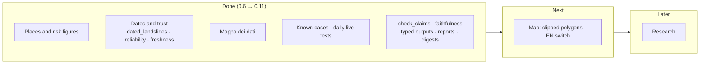

# Roadmap & AI

Where ispra-idrogeo stands at **0.11.0** (23 November 2026), and what would
make it more useful. These are directions, not promises: open an issue to
discuss one before starting. The roadmaps that brought it here are
[#11](https://github.com/agent-engineering-studio/ispra-idrogeo/issues/11)
and [#23](https://github.com/agent-engineering-studio/ispra-idrogeo/issues/23)
(the AI layer), both closed.

## Where we are

| Area | Today | Gap |
|---|---|---|
| **Data** | Every open-data layer and mosaic (PAI 2024 too), conditional downloads, a local DuckDB warehouse | – |
| **Places** | `hazard_at`, `landslides_near`, `iter_landslides_in`; risk figures of all 7,899 towns | PAI polygons clipped to a box, not to the town's outline, on the map |
| **Trust** | `dated_landslides` with their precision, `reliability` per town, `freshness` of every file | No reference to measure how complete IFFI is |
| **People** | The *Mappa dei dati* for public bodies, in Docker, with `publiccode.yml` | Italian only; no WCAG audit |
| **AI agents** | `idrogeo-mcp`: 19 typed tools with source, licence and time in every answer; `check_answer` with `check_claims` (who said what); a faithfulness benchmark in CI; `idrogeo report` and `idrogeo digest`; `SKILL.md`, `llms-full.txt`; an eval (pilot 5/5) | Whether agents now call `check_answer` is not yet measured (pilot: 0/5) |
| **Quality** | 100% coverage, `mypy --strict`, known cases replayed in CI, live contract tests every day | – |

## Status

| # | Feature | Kind | Status |
|---|---|---|---|
| 1 | Point queries: `hazard_at`, `landslides_near` (WMS) | Core | ✅ 0.6.0 |
| 2 | Landslides of an area: `iter_landslides_in` | Core | ✅ 0.6.0 |
| 3 | `idrogeo watch`, progress bar, example notebooks | DX | ✅ 0.6.0 |
| 4 | MCP over streamable HTTP, `/health`, env configuration | AI | ✅ 0.6.0 |
| 5 | `llms.txt` for coding assistants | AI | ✅ 0.7.0 |
| 6 | MCP `rank_areas`, `compare_areas`, resources, prompts | AI | ✅ 0.7.0 |
| 7 | Local DuckDB warehouse with read-only SQL for agents | Core · AI | ✅ 0.7.0 |
| 8 | Live contract tests, every day since 0.10.0, opening an issue on drift | Quality | ✅ 0.7.0 |
| 9 | Agent evaluation suite (`make eval`, needs an Anthropic key) | AI | ✅ 0.8.0, pilot 5/5 correct |
| 10 | Source, licence and time in every MCP answer; `check_text` / `check_answer` | AI | ✅ 0.8.0 |
| 11 | PAI landslide mosaic 2024 (`pai_frane_2024`), File Geodatabases in the warehouse | Data | ✅ 0.9.0 |
| 12 | Dated landslides with their precision (`dated_landslides`) | Data | ✅ 0.9.0 |
| 13 | How far to trust IFFI, town by town (`reliability`) | Data | ✅ 0.9.0 |
| 14 | Benchmark of known cases, replayed offline in CI | Quality | ✅ 0.10.0 |
| 15 | Freshness of every published file (`freshness`) | Data | ✅ 0.10.0 |
| 16 | Agent skill (`SKILL.md`) and `llms-full.txt` | AI | ✅ 0.10.0 |
| 17 | *Mappa dei dati* for public bodies, predisposition classes | People | ✅ 0.10.0 |
| 18 | `check_claims`, faithfulness benchmark, typed tool outputs, area reports, change digests | AI | ✅ 0.11.0 ([#23](https://github.com/agent-engineering-studio/ispra-idrogeo/issues/23)) |
| 19 | Map: polygons clipped to the town, EN switch, screenshot | People | ⏳ |
| 20 | Landslide susceptibility baseline (notebook) | Research | 💡 |
| 21 | News → candidate events, for review | Research | 💡 |

---

## Done

### The AI layer, phase 5 ([#23](https://github.com/agent-engineering-studio/ispra-idrogeo/issues/23), 0.11.0)

- **`check_claims`**: a real number said of the wrong indicator ("Bari ha
  4.038 residenti", where 4,038 are the people in flood hazard) is flagged.
  `check_answer` and `idrogeo check` run it with `check_text`.
- **A faithfulness benchmark**, free and offline in CI: 18 answers labeled
  by hand. Swaps caught: 0/6 by `check_text`, 5/6 with `check_claims`; no
  false alarm on the 8 good answers.
- **`check_answer` before every number**: stronger instructions, and the
  eval reports "checks its answer: x/y".
- **Typed outputs**: every MCP tool publishes an output schema.
- **`idrogeo report <comune>`**: a page in Italian from a template, every
  number checked; `--summary` adds a model's summary, checked before it is
  written.
- **`idrogeo digest`**: files, records and events changed since the last
  digest.

### Before (0.6 → 0.10)

Rank and compare (`rank_areas`, `compare_areas`), the local DuckDB
warehouse, live contract tests every day, the agent eval with true answers
computed from the live data, dated landslides, reliability per town,
freshness, the agent skill and the *Mappa dei dati*. The details are in the
[changelog](changelog.md).

---

## Later: AI features

!!! tip "The design rule for every AI feature here"
    **Numbers come from the data, words from the model.** The library
    assembles the figures deterministically; the model only writes prose
    around them, and a checker verifies that every number in the text appears
    in the data. Every output cites ISPRA — IdroGEO and says it is not an
    official hazard assessment.

### Next

- An English version of `idrogeo report`, and HTML output.
- A digest by region or province (`--region`), for a newsletter or a
  council briefing.

---

## Research directions

### A landslide susceptibility baseline

A notebook that trains a simple model (gradient boosting) for one region.
IFFI landslides are the positives; slope, lithology (both already returned by
`hazard_at`), land cover and rainfall are the features. It serves as teaching
material and as a baseline for
[Limen](https://github.com/agent-engineering-studio/limen). Two honest
caveats, written into the notebook: IFFI is incomplete where surveys were
fewer (sampling bias), and a model is **not** a substitute for the official
PAI hazard maps.

### News → candidate events

A pipeline that reads local news feeds, has a model extract *when, where,
what type*, geocodes it, and matches it to IFFI and IdroGEO events. Output:
**candidates** for review, clearly separated from official data, never
written back as if they were ISPRA records.

---

## Not AI, still important

- 🧩 **GeoServer bootstrap** for [mcp-geo-server](https://github.com/agent-engineering-studio/mcp-geo-server).
- 🗺️ **A static explorer on this site**: a nightly workflow writes the 7,899
  municipalities' indicators to JSON, and a page shows them on a map with
  search. No server, no API key.
- 🏷️ **A clear User-Agent** with the library's version, so ISPRA can see and
  reach its users.
- ❓ **Ask ISPRA** which edition the API's landslide hazard indicators use, and
  whether it will be published for download.

## How to help

Pick a row, open an issue saying which one, and read
[Contributing](contributing.md). The English report and the digest by region are
good first contributions.
