# Roadmap & AI

Where ispra-idrogeo stands at **0.6.0** (November 2026), and the improvements
and AI features that would make it more useful. These are directions, not
promises: open an issue to discuss one before starting.

## Where we are

| Area | Today | Gap |
|---|---|---|
| **Downloads** | Every open-data layer and mosaic, conditional GET, atomic swap, progress bar | – |
| **Points and areas** | `hazard_at` and `landslides_near` through IdroGEO's public WMS; `iter_landslides_in` with exact area counts | One point per request: nothing for thousands of points, or offline ([#4](https://github.com/agent-engineering-studio/ispra-idrogeo/pull/4)) |
| **Changes** | `idrogeo watch`, resumable, for cron | No summary a person reads in a minute |
| **AI agents** | `idrogeo-mcp`: 12 tools, stdio and streamable HTTP with `/health` | No way to rank or compare areas ([#1](https://github.com/agent-engineering-studio/ispra-idrogeo/pull/1)); no measure of how well an agent uses the tools; untyped outputs |
| **Quality** | `mypy --strict`, 100% coverage, mocked transport, notebooks run on the live service | Nothing notices when ISPRA moves a path again (see [Known traps](traps.md)) |

The library now answers "what is at this place?". The next step is for agents
to **use** it well, and to have that checked: ranking and comparing without
doing arithmetic in their heads, SQL for the questions no tool foresees, and a
test suite of questions with known answers.

## Status

| # | Feature | Kind | Status |
|---|---|---|---|
| 1 | Point queries: `hazard_at`, `landslides_near` (WMS) | Core | ✅ 0.6.0 |
| 2 | Landslides of an area: `iter_landslides_in` | Core | ✅ 0.6.0 |
| 3 | `idrogeo watch`, progress bar, example notebooks | DX | ✅ 0.6.0 |
| 4 | MCP over streamable HTTP, `/health`, env configuration | AI | ✅ 0.6.0 |
| 5 | `llms.txt` for coding assistants | AI | ✅ this site |
| 6 | MCP `rank_areas`, `compare_areas`, resources, prompts, accent-insensitive `find_area` | AI | 🔄 [#1](https://github.com/agent-engineering-studio/ispra-idrogeo/pull/1) |
| 7 | Local DuckDB warehouse, offline, with read-only SQL for agents (`warehouse_sql`) | Core · AI | 🔄 [#4](https://github.com/agent-engineering-studio/ispra-idrogeo/pull/4) |
| 8 | Live contract tests, weekly, opening an issue on drift | Quality | ⏳ next |
| 9 | Agent evaluation suite: questions with checked answers | AI | ⏳ next |
| 10 | Typed tool outputs (`TypedDict`) and citations on every answer | AI | ⏳ |
| 11 | Grounded area reports (`idrogeo report <comune>`) | AI | ⏳ |
| 12 | AI digests on top of `idrogeo watch` | AI | ⏳ |
| 13 | An agent skill for coding assistants (`SKILL.md`) | AI | ⏳ |
| 14 | Container image for `idrogeo-mcp`; Python 3.14 in CI | DX | ⏳ |
| 15 | Landslide susceptibility baseline (notebook) | Research | 💡 |
| 16 | News → candidate events, for review | Research | 💡 |

```mermaid
flowchart LR
    subgraph D["Done in 0.6.0"]
        direction TB
        P["hazard_at · landslides_near<br/>(WMS)"]
        W0["watch · notebooks"]
        H["MCP over HTTP"]
    end
    subgraph R["In review"]
        direction TB
        RK["rank_areas · compare_areas<br/>resources · prompts (#1)"]
        WH["Warehouse + SQL (#4)"]
    end
    subgraph N["Next"]
        direction TB
        C["Live contract tests"]
        E["Agent eval suite"]
        T["Typed outputs"]
    end
    subgraph L["Later"]
        direction TB
        RP["Grounded reports"]
        DG["Change digests"]
        S["Research"]
    end
    D --> R --> N --> L
```



---

## In review

### Rank and compare, explain the indicators ([#1](https://github.com/agent-engineering-studio/ispra-idrogeo/pull/1))

`rank_areas` (top or bottom areas by any indicator, inside a region or
province) and `compare_areas` (up to 20 side by side) so the agent quotes
numbers instead of computing them. The resource `idrogeo://indicators`
explains keys such as `popfrp3p4p`; two prompts, `area_profile` and
`recent_events`, show clients how to chain the tools. `find_area` ignores
accents and suggests close names.

### A local warehouse, offline and in SQL ([#4](https://github.com/agent-engineering-studio/ispra-idrogeo/pull/4))

`idrogeo sync` keeps the layers in one DuckDB file, R-tree indexed, in
EPSG:32632. It is for what one WMS request per point cannot do: thousands of
points, work offline, joins. `warehouse_sql` lets an agent write its own
query. The file is opened read-only with DuckDB's access to files and URLs
switched off, so a prompt-injected `read_text('~/.ssh/…')` fails.

Building it turned up four facts now in [Known traps](traps.md):

- the hazard mosaics are **CC BY-SA 4.0**;
- the flood mosaic is in **EPSG:3035**;
- the IFFI shapefiles are **ISO-8859-1**;
- the API's landslide hazard areas add up to ~15% more than the mosaic you can download.

---

## Next

### Live contract tests

The [Known traps](traps.md) table was checked by hand. A scheduled workflow
(`pytest -m live`, weekly) can check it every week: every path still answers,
every field the library reads is still there, the `304` still comes back. On
failure it opens an issue. ISPRA changes paths without notice; this is how
the library notices first.

### Agent evaluation suite

!!! tip "Tool descriptions are prompts: test them like code"
    A set of 50–100 questions (*"residents in flood hazard P2 in Bari"*,
    *"is piazza San Marco in a flood zone?"*, *"the five municipalities of
    Campania with the most residents in landslide hazard P3+P4"*) whose
    answers are computed from the API, run against an agent connected to
    `idrogeo-mcp`. It measures whether the agent picks the right tools, with
    the right codes, and reports the right numbers. Run on demand (it costs
    model calls), not in every CI build.

### Typed outputs and citations

`TypedDict` results give each tool an output schema, so agents stop guessing
what a key means, and Python users get completion. Every answer carries
`source`, `licence` and `retrieved_at`, so the credit ISPRA asks for survives
into the agent's final answer. `rank_areas` and `compare_areas` already do it.

---

## Later: AI features

!!! tip "The design rule for every AI feature here"
    **Numbers come from the data, words from the model.** The library
    assembles the figures deterministically; the model only writes prose
    around them, and a checker verifies that every number in the text appears
    in the data. Every output cites ISPRA — IdroGEO and says it is not an
    official hazard assessment.

### Grounded area reports

```bash
pip install "ispra-idrogeo[ai]"
idrogeo report sarno --lang it --format html > sarno.html
```

A one-page profile of a municipality: hazard and exposure by class,
landslides by type, recent events, monitoring, compared with its province and
region. The data part works with no model at all (a template). With an API
key, a model writes a plain-language summary for citizens, journalists or
council members, in Italian or English, behind a small model-agnostic
interface.

### Change digests

On top of `idrogeo watch`: *"This week in Liguria: 14 new events, 9 after the
rain of 28 October in the province of Genova…"*, grounded in the records it
lists, for a newsletter, a Slack channel or a council briefing.

### An agent skill

A `SKILL.md` in the repository teaches Claude Code and similar tools the
recipes: which layer for which question, `(lat, lon)` order, EPSG:32632 vs
3857 vs 3035, why not to filter landslides by `regione`.

---

## Research directions

### A landslide susceptibility baseline

A notebook that trains a simple model (gradient boosting) for one region.
IFFI landslides are the positives; slope, lithology (both already returned by
`hazard_at`), land cover and rainfall are the features. It serves as teaching
material and as a baseline for
[Limen](https://github.com/agent-engineering-studio/limen). Two honest
caveats, written into the notebook: IFFI is incomplete where surveys were
fewer (sampling bias), and a model is **not** a substitute for the official
PAI hazard maps.

### News → candidate events

A pipeline that reads local news feeds, has a model extract *when, where,
what type*, geocodes it, and matches it to IFFI and IdroGEO events. Output:
**candidates** for review, clearly separated from official data, never
written back as if they were ISPRA records.

---

## Not AI, still important

- 🧩 **GeoServer bootstrap** for [mcp-geo-server](https://github.com/agent-engineering-studio/mcp-geo-server).
- 🗺️ **A static explorer on this site**: a nightly workflow writes the 7,899
  municipalities' indicators to JSON, and a page shows them on a map with
  search. No server, no API key.
- 🏷️ **A clear User-Agent** with the library's version, so ISPRA can see and
  reach its users.
- ❓ **Ask ISPRA** which edition the API's landslide hazard indicators use, and
  whether it will be published for download.

## How to help

Pick a row, open an issue saying which one, and read
[Contributing](contributing.md). Live contract tests, typed outputs and the
agent skill are good first contributions.
